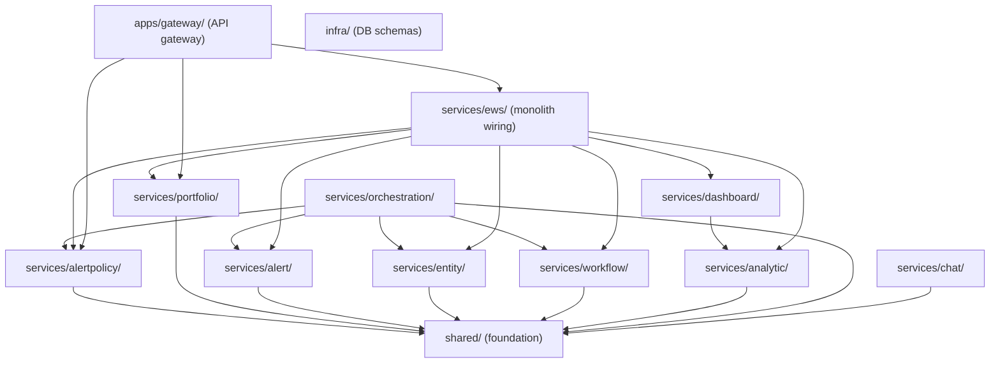

# Selective Service Merge Strategy

## Why Not Cherry-Pick?

The 29 commits on `feature/boomi/main_phase15` are organized by development phase, not by service. Each commit touches multiple services simultaneously (e.g., "all domain api services - completed with unit tests"). Cherry-picking would bring in unwanted services. Instead, we use **selective file checkout** on a release branch.

## Dependency Graph (What Must Come With What)




Key insight: `alertpolicy` and `portfolio` both depend only on `shared` -- they have no cross-dependencies on other new services. This makes them ideal first candidates.

## The Repeatable Process (For Any Release)

### Step 1: Create a release branch from main

```
git checkout main
git pull origin main
git checkout -b release/v1-alertpolicy-portfolio
```

### Step 2: Pull in the foundation layer (`shared/`)

Both target services depend on the rewritten `shared` package. Pull the entire directory:

```
git checkout feature/boomi/main_phase15 -- shared/
```

This brings in ~27 changed files including auth, config/settings, streaming, checkpointer, models, and tests.

### Step 3: Pull in the target service directories

```
git checkout feature/boomi/main_phase16 -- services/alert/
git checkout feature/boomi/main_phase16 -- services/alertpolicy/
git checkout feature/boomi/main_phase16 -- services/portfolio/
```

These are net-new directories (don't exist on main), so no conflict risk.

### Step 4: Pull in infrastructure files

```
git checkout feature/boomi/main_phase15 -- infra/postgres/alertpolicy/
git checkout feature/boomi/main_phase15 -- infra/databricks/vm_alert_policies.sql
git checkout feature/boomi/main_phase15 -- infra/databricks/portfolio_settings.sql
git checkout feature/boomi/main_phase15 -- infra/postgres/init-ews.sh
```

### Step 5: Manually adapt the wiring files

These files on the feature branch reference ALL services. They need hand-editing to only include alertpolicy + portfolio.

#### 5a. Root [pyproject.toml](pyproject.toml) -- add only the 2 new workspace members

On main it has 3 members (`shared`, `apps/gateway`, `services/ews`). Add only:

```toml
[tool.uv.workspace]
members = [
    "shared",
    "apps/gateway",
    "services/ews",
    "services/alertpolicy",   # NEW
    "services/portfolio",     # NEW
]
```

Also bring over the `[tool.pytest.ini_options]` and `[dependency-groups]` sections from the feature branch, and the `grandalf` dependency if needed.

#### 5b. [services/ews/pyproject.toml](services/ews/pyproject.toml) -- trim dependencies

On the feature branch, EWS depends on all 8 services. Trim to only:

```toml
dependencies = [
    "fastapi>=0.100.0",
    "uvicorn[standard]>=0.23.0",
    "shared",
    "alertpolicy",
    "portfolio",
]

[tool.uv.sources]
shared = { workspace = true }
alertpolicy = { workspace = true }
portfolio = { workspace = true }
```

#### 5c. [services/ews/src/ews/main.py](services/ews/src/ews/main.py) -- mount only 2 routers

Write a trimmed version that only imports alertpolicy + portfolio:

```python
from alertpolicy.router import router as alertpolicy_router
from portfolio.router import router as portfolio_router

app.include_router(alertpolicy_router, prefix="/api/alertpolicies")
app.include_router(portfolio_router, prefix="/api/portfolio")
```

Remove entity, alert, workflow, analytic, dashboard, ci imports. Keep the health endpoint but only list alertpolicy + portfolio as active.

#### 5d. [apps/gateway/pyproject.toml](apps/gateway/pyproject.toml) -- trim dependencies

```toml
dependencies = [
    "fastapi",
    "uvicorn[standard]>=0.23.0",
    "httpx>=0.28.1",
    "shared",
    "ews",
    "portfolio",
]

[tool.uv.sources]
shared = { workspace = true }
ews = { workspace = true }
portfolio = { workspace = true }
```

#### 5e. [apps/gateway/src/gateway/main.py](apps/gateway/src/gateway/main.py) -- selective routing

Pull the file from feature, then remove imports/routers for services not yet released (entity, alert, analytic, dashboard, chat, orchestration). Keep only:

- `alertpolicy_router`
- `portfolio_router`
- `auth_router` (if auth is needed)
- `health_router`

Also pull the corresponding gateway route files:

```
git checkout feature/boomi/main_phase15 -- apps/gateway/src/gateway/routes/alertpolicy.py
git checkout feature/boomi/main_phase15 -- apps/gateway/src/gateway/routes/portfolio.py
git checkout feature/boomi/main_phase15 -- apps/gateway/src/gateway/proxy.py
```

Retain old route files (alerts.py, entities.py, etc.) if backward compat is needed, or remove them.

#### 5f. EWS tests -- pull selectively

```
git checkout feature/boomi/main_phase15 -- services/ews/tests/test_main.py
git checkout feature/boomi/main_phase15 -- services/ews/tests/test_endpoint_validation.py
```

Then trim these test files to only validate alertpolicy + portfolio endpoints.

### Step 6: Pull supporting files

```
git checkout feature/boomi/main_phase15 -- .dockerignore
git checkout feature/boomi/main_phase15 -- .gitignore
git checkout feature/boomi/main_phase15 -- docker-compose.yml
git checkout feature/boomi/main_phase15 -- services/ews/Dockerfile
git checkout feature/boomi/main_phase15 -- apps/gateway/Dockerfile
```

Then edit `docker-compose.yml` to remove containers for services not yet released (orchestration, chat).

### Step 7: Regenerate lockfile and test

```
uv sync
uv run pytest services/alertpolicy/
uv run pytest services/portfolio/
uv run pytest services/ews/
uv run pytest apps/gateway/
```

### Step 8: Commit and merge to main

```
git add -A
git commit -m "release: alertpolicy + portfolio services"
git checkout main
git merge release/v1-alertpolicy-portfolio
```

---

## Future Releases (Repeatable Pattern)

For each subsequent release, follow the same pattern:


| Release | New Services        | Additional Dependencies                         |
| ------- | ------------------- | ----------------------------------------------- |
| v2      | alert, entity       | (both depend only on shared)                    |
| v3      | workflow            | (depends only on shared)                        |
| v4      | analytic, dashboard | dashboard depends on analytic                   |
| v5      | orchestration       | depends on alert, alertpolicy, entity, workflow |
| v6      | chat                | depends only on shared                          |
| v7      | kpi_evaluation      | standalone Databricks package                   |


Each release branch:

1. Branches from current main (which already has prior releases)
2. Checks out new service dirs from feature branch
3. Adds new workspace members to root `pyproject.toml`
4. Adds new deps + routers to EWS and gateway
5. Adds new infra files
6. Tests and merges

## Risks and Mitigations

- **shared/ changes breaking existing main code**: The old gateway on main uses `shared.auth.dependencies` which is being rewritten. Pull the full shared package early and fix any breakage in existing code.
- **uv.lock conflicts**: Always regenerate with `uv sync` after selective checkouts. Never checkout `uv.lock` from the feature branch.
- **Test failures from missing services**: The feature branch tests may reference services not yet merged. Always trim test files to match the services present.
- **Gateway old vs new routes**: On main, gateway has old mock-based routes (loans, precursors, etc.). Decide whether to keep them for backward compatibility or remove them in release v1.

