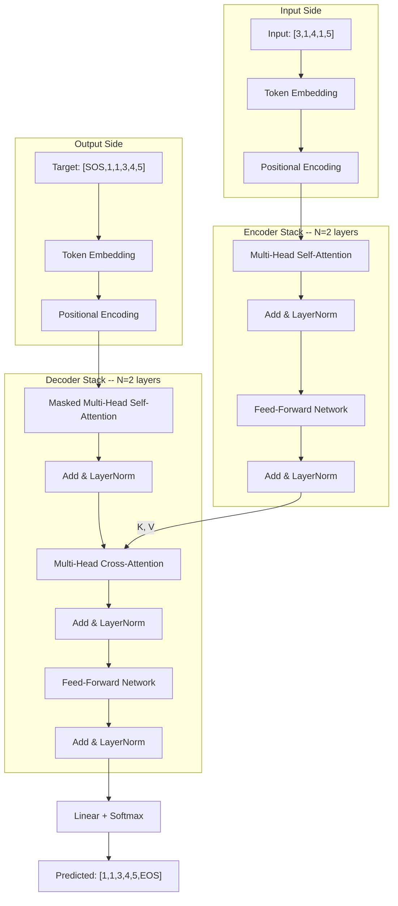
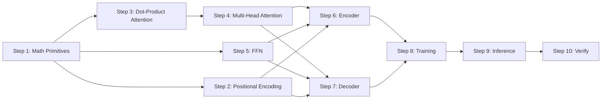

# Transformer from Scratch -- Overview

> **Paper**: "Attention Is All You Need" (Vaswani et al., 2017)
> **arXiv**: [1706.03762v7](https://arxiv.org/abs/1706.03762)
> **Our goal**: Implement every component in pure NumPy, understand every gradient, train on a toy sort task.

---

## What Problem Does the Transformer Solve?

The Transformer is a **sequence-to-sequence** (seq2seq) model. It takes a sequence of tokens as
input and produces a sequence of tokens as output. Examples:

- **Machine translation**: "I like cats" -> "J'aime les chats"
- **Summarization**: long paragraph -> short summary
- **Our task**: `[3, 1, 4, 1, 5]` -> `[1, 1, 3, 4, 5]` (sorting)

Before the Transformer, the dominant approach was **Recurrent Neural Networks** (RNNs/LSTMs).
The key problems with RNNs:

1. **Sequential processing** -- must process token 1 before token 2 before token 3... (slow)
2. **Long-range dependencies** -- by the time you reach token 100, you've "forgotten" token 1
3. **Cannot parallelize** -- each step depends on the previous step

The Transformer replaces recurrence with **attention** -- every token can directly look at every
other token in a single operation. This is:

- **Parallelizable** -- all positions computed simultaneously
- **Constant path length** -- token 1 and token 100 are one step apart
- **Faster to train** -- 12 hours on 8 GPUs vs. days/weeks for RNNs

---

## Architecture (Paper Figure 1)

The Transformer has two halves: an **Encoder** (reads the input) and a **Decoder** (generates
the output). Here's how they connect:



### Data Flow Summary

1. **Input tokens** are embedded and combined with positional encoding
2. The **Encoder** processes the full input through self-attention + FFN (repeated N times)
3. **Output tokens** (shifted right, starting with SOS) are embedded with positional encoding
4. The **Decoder** processes targets through:
   - Masked self-attention (can only see past tokens, not future)
   - Cross-attention (looks at encoder output -- this is where input meets output)
   - FFN
5. A final linear layer + softmax predicts the next token at each position

---

## Component Inventory

Every piece we'll build, mapped to the paper:

| # | Component | Paper Section | Key Equation | Learnable Params? |
|---|-----------|---------------|--------------|-------------------|
| 1a | Linear layer | (prerequisite) | y = xW + b | Yes: W, b |
| 1b | Softmax | (prerequisite) | softmax(x_i) = e^{x_i} / sum(e^{x_j}) | No |
| 1c | ReLU | (prerequisite) | max(0, x) | No |
| 1d | Layer Normalization | Section 3.1 | normalize then scale+shift | Yes: gamma, beta |
| 1e | Dropout | Section 5.4 | random zero-out mask | No |
| 1f | Embedding | Section 3.4 | lookup table | Yes: embedding matrix |
| 2 | Positional Encoding | Section 3.5 | PE(pos,2i) = sin(pos/10000^{2i/d}) | No (fixed) |
| 3 | Scaled Dot-Product Attention | Section 3.2.1, Eq 1 | softmax(QK^T / sqrt(d_k)) V | No |
| 4 | Multi-Head Attention | Section 3.2.2 | Concat(head_1..h) W^O | Yes: W^Q, W^K, W^V, W^O |
| 5 | Feed-Forward Network | Section 3.3, Eq 2 | max(0, xW1+b1)W2+b2 | Yes: W1, b1, W2, b2 |
| 6 | Encoder Layer + Stack | Section 3.1 | (composition) | (from sub-components) |
| 7 | Decoder Layer + Stack | Section 3.1 | (composition) | (from sub-components) |
| 8 | Training Pipeline | Section 5 | Adam + LR warmup + label smoothing | -- |
| 9 | Greedy Decoding | (inference) | argmax at each step | -- |
| 10 | Verification | (testing) | gradient check + visualization | -- |

---

## Configuration: Paper vs. Our Toy Model

We scale everything down so it runs on a CPU in seconds, while keeping the same architecture:

| Parameter | Paper Value | Our Value | Why |
|-----------|-------------|-----------|-----|
| d_model (embedding dim) | 512 | **32** | 16x smaller -- still enough to learn sorting |
| N (encoder/decoder layers) | 6 | **2** | Sorting doesn't need deep stacks |
| h (attention heads) | 8 | **4** | 4 heads * 8 dims = 32 = d_model |
| d_k = d_v (per-head dim) | 64 | **8** | d_model / h = 32 / 4 |
| d_ff (FFN inner dim) | 2048 | **64** | 2x d_model (paper uses 4x) |
| P_drop (dropout rate) | 0.1 | **0.1** | Same as paper |
| warmup_steps | 4000 | **400** | Scaled down proportionally |
| Vocabulary | 37000 | **13** | Numbers 0-9 + PAD + SOS + EOS |
| Sequence length | varies | **5** (input) | Short enough to trace by hand |
| Batch size | ~25K tokens | **32** sequences | Fits in CPU memory |

---

## Our Task: Sorting Numbers

**Input**: a sequence of 5 random digits (0-9)
**Output**: the same digits in sorted order

```
Encoder input:  [3, 1, 4, 1, 5]         (length 5)
Decoder input:  [SOS, 1, 1, 3, 4, 5]    (length 6 -- shifted right)
Decoder target: [1, 1, 3, 4, 5, EOS]    (length 6 -- what we predict)
```

Why this task?
- **Non-trivial**: the model must learn to compare and reorder (not just copy)
- **Easy to verify**: we can check if output is sorted
- **Small vocabulary**: only 13 tokens, so embeddings are tiny
- **Short sequences**: we can trace attention patterns by hand

### Special Tokens

| Token | ID | Purpose |
|-------|----|---------|
| 0-9 | 0-9 | The actual number digits |
| PAD | 10 | Padding for variable-length sequences (not needed for fixed length, but good practice) |
| SOS | 11 | Start Of Sequence -- tells decoder to begin generating |
| EOS | 12 | End Of Sequence -- tells decoder to stop |

---

## Glossary

| Term | Meaning |
|------|---------|
| **d_model** | Dimension of token embeddings and all internal representations (our: 32) |
| **d_k** | Dimension of keys and queries in attention (our: 8) |
| **d_v** | Dimension of values in attention (our: 8) |
| **d_ff** | Inner dimension of the feed-forward network (our: 64) |
| **N** | Number of encoder/decoder layers stacked (our: 2) |
| **h** | Number of attention heads (our: 4) |
| **Q, K, V** | Query, Key, Value -- the three inputs to attention |
| **Residual connection** | Add the input back to the output: `output = x + sublayer(x)` -- helps gradients flow |
| **Layer normalization** | Normalize activations to mean=0, var=1 across features -- stabilizes training |
| **Causal mask** | Prevents decoder from seeing future tokens during training |
| **Auto-regressive** | Generating one token at a time, feeding each prediction back as input |
| **Label smoothing** | Soften target from [0,0,1,0] to [0.017,0.017,0.95,0.017] -- prevents overconfidence |
| **Warmup** | Gradually increase learning rate at start of training, then decay |
| **Teacher forcing** | During training, feed the real target tokens (not predictions) to the decoder |

---

## Build Order (and Why This Order)



**Why this order?**

- **Step 1 first**: everything is built on Linear, Softmax, ReLU, LayerNorm. No point building
  attention if you can't multiply matrices and compute gradients through them.
- **Steps 2-5 are the building blocks**: they can be tested in isolation before assembling.
- **Steps 6-7 compose the blocks**: encoder and decoder are just stacks of attention + FFN.
- **Step 8 needs the full model**: training requires both encoder and decoder wired together.
- **Steps 9-10 need a trained model**: can't decode or visualize without trained weights.

---

## Project Layout

This project is a **uv workspace** with two parallel implementations and shared docs:

```
nn/
├── pyproject.toml                          # workspace root
├── docs/                                   # shared documentation (this folder)
│   ├── 00_overview.md ... 10_verification.md
│   └── reference_tokenization.md
├── numpy-transformer/                      # pure NumPy implementation
│   ├── pyproject.toml
│   ├── src/numpy_transformer/
│   │   ├── __init__.py
│   │   └── layers.py
│   └── tests/test_layers.py
└── pytorch-transformer/                    # PyTorch implementation (future)
    ├── pyproject.toml
    ├── src/pytorch_transformer/
    │   ├── __init__.py
    │   └── layers.py
    └── tests/test_layers.py
```

### Common Commands

```bash
# Install dependencies (from nn/)
uv sync --package numpy-transformer

# Run tests
uv run --package numpy-transformer pytest

# Import in code
from numpy_transformer.layers import Linear, Softmax, ReLU, LayerNorm, Dropout, Embedding
```

---

## How to Use These Docs

- **`00_overview.md`** (this file) -- your map. Come back here when lost.
- **`01_xxx.md` through `10_xxx.md`** -- one per step. Each has:
  - Paper reference (section + equation)
  - Plain-English explanation
  - Key equations with variable definitions
  - Status marker (Not started / In progress / Complete)
- **When exploring a tangent** -- note which step you were on, explore freely, then return.
- **Each doc links back here** and to its neighbors (previous/next step).

---

## Status Tracker

Per-step progress lives in [STATUS.md](STATUS.md). This overview stays stable;
`STATUS.md` is updated as each step lands.
