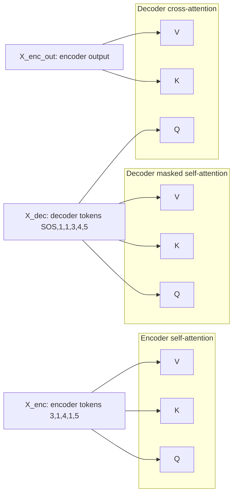
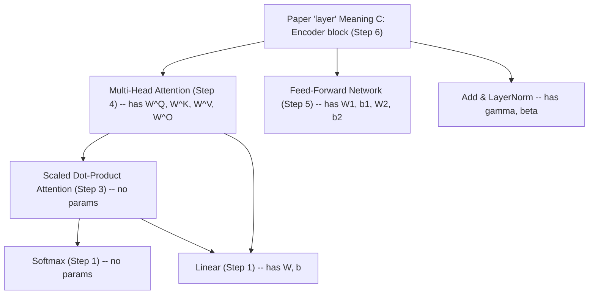

# Step 3: Scaled Dot-Product Attention

> **Status**: Complete (notes + `ScaledDotProductAttention` + tests)
> **Paper section**: Section 3.2.1, Equation 1
> **Depends on**: Step 2 (Positional Encoding)

[< Positional Encoding](02_positional_encoding.md) | [Overview](00_overview.md) | [Next: Multi-Head Attention >](04_multi_head_attention.md)

---

## What We Build

A **parameter-free** operator that takes queries `Q`, keys `K`, and values `V`
and produces, for each query position, a **soft, content-based mixture** of all
value positions. Formally (paper Equation 1):

```
Attention(Q, K, V) = softmax(Q K^T / sqrt(d_k)) V
```

Scaled dot-product attention is the central mechanism of the Transformer. The
learnable pieces that feed it (the `W^Q, W^K, W^V, W^O` projections) live in
Step 4 (Multi-Head Attention). Step 3 studies the pure operation itself, taking
`Q, K, V` as given.

This doc is built up **one concept at a time** (10 items). Each item is a
sub-section. A chronological Discussion Log lives at the bottom.

---

## 1. What problem does attention solve?

### Where we stand after Step 2

After embedding + positional encoding, each token at position `pos` in a
sequence of length `n` is a vector in `R^{d_model}`. Concretely, the tensor has
shape `(batch, n, d_model)`. For our toy sort task with `n = 5`, `d_model = 32`,
and input `[3, 1, 4, 1, 5]`:

```
row 0 (token=3, pos=0): embedding(3) + PE(0)
row 1 (token=1, pos=1): embedding(1) + PE(1)
row 2 (token=4, pos=2): embedding(4) + PE(2)
row 3 (token=1, pos=3): embedding(1) + PE(3)
row 4 (token=5, pos=4): embedding(5) + PE(4)
```

Each row carries exactly two pieces of information:

1. **Identity** -- which token I am (from the embedding lookup).
2. **Location** -- where I sit in the sequence (from positional encoding).

That's it. Row 0 does **not** know that row 2 is a 4, or that row 4 is a 5.
Every row is an island.

### Why that isn't enough

To **sort** `[3, 1, 4, 1, 5]`, the encoder needs to produce, for each position,
a vector that somehow encodes "here's my value, and here's how I compare to my
neighbors." Position 0 (value 3) should emerge from the encoder with an
internal representation that effectively says "I am a 3, there are smaller
values (1, 1) and larger values (4, 5) around me, and the 1s come before the 4
and the 5." The decoder will later exploit that representation to generate
`[1, 1, 3, 4, 5, EOS]`.

So the encoder needs a **mixing operator** that lets each row absorb
information from the other rows.

The same need appears everywhere -- it is not specific to sorting:

- Translation: "bank" in "river bank" vs "savings bank" must be disambiguated
  by its neighbors.
- Summarization: the encoder has to build a compressed representation of the
  whole input, which means every token must be influenced by every other.
- Coreference: "she" at position 20 must look back at "Alice" at position 3.

### Why not the pre-2017 approaches?

There are three ways you could imagine doing this mixing. The Transformer is
the third.

**Option A -- Flatten and use a big MLP.** Reshape `(n, d_model)` to a single
vector of length `n * d_model`, feed to a dense network. Problems:

- **Fixed `n`**. You'd need to retrain for every sequence length. Real tasks
  have variable lengths.
- **No translation invariance**. A pattern learned at positions (2, 5) does
  not help at positions (3, 6). You waste parameters relearning the same
  thing at every shift.
- **Parameter explosion**. Input dim is `n * d_model`. For `n = 100`,
  `d_model = 512`, and a hidden layer of 512, that is ~26M parameters in a
  single layer.

**Option B -- Recurrent network (RNN, LSTM, GRU).** Process tokens
left-to-right (and maybe right-to-left too, for bidirectional), maintaining a
hidden state `h_t` that "remembers" history: `h_t = f(h_{t-1}, x_t)`. This was
the dominant approach 2014-2017. Three pain points:

- **Sequential bottleneck**. `h_t` depends on `h_{t-1}`, which depends on
  `h_{t-2}`, ... Steps must be computed **in order**. This is a disaster for
  GPUs, which want to do thousands of operations in parallel. Training is
  slow.
- **Long-range decay**. Information from token 1 reaches token 100 only by
  propagating through 99 intermediate `f` applications. Gradients vanish (or
  explode) exponentially in depth. LSTMs and GRUs help but do not eliminate
  the problem.
- **Path length = `O(n)`**. For token `i` to influence token `j`, the signal
  travels `|i - j|` steps through the network. Long-range dependencies are
  structurally disadvantaged.

**Option C -- Attention.** Let every position directly read every other
position, in **one** step, with **data-dependent weights**:

```
new_row_i = sum over j of weight(i, j) * value(row_j)
```

where `weight(i, j)` is computed from rows `i` and `j` via a soft, differentiable
scoring function (we'll see it's a scaled dot product), and the weights for
query `i` sum to 1 over all keys `j`.

What this buys you vs. RNNs:

- **Parallelizable**. All `(i, j)` pairs can be computed simultaneously. Two
  big matmuls and a softmax on a GPU, done.
- **Constant path length**. Token 1 and token 100 are one step apart. No
  exponential decay.
- **Content-based mixing**. The weights depend on the actual values in
  `row_i` and `row_j`, not on fixed positional patterns. Two tokens that are
  semantically related get mixed more, regardless of distance.

And vs. a flattened MLP:

- **Variable `n` works natively**. Same parameters handle `n = 5` or `n = 500`;
  only the cost of the mixing step changes.
- **Permutation-equivariant**. If you permute the input rows, the output rows
  permute the same way (before positional encoding is added). Structure is
  learned from data, not hard-wired.

### The paper's quote

Vaswani et al. (2017) frame it exactly this way in the introduction and in
Table 1 of the paper, which compares layer types by three axes: **computational
cost per layer**, **sequential operations**, and **maximum path length between
any two positions**. Attention wins the last two outright: sequential = `O(1)`
(everything parallel per layer), path length = `O(1)` (everyone can reach
everyone in one hop). The cost per layer is `O(n^2 * d)`, which is the price.

### One-line takeaway

**Attention is the operator that turns an "island of tokens" into a "sequence
of context-aware vectors," without the sequential bottleneck of RNNs or the
parameter blow-up of a big MLP.** Everything Step 3 builds is the specific
mathematical form of that operator; everything Step 4 adds is the learnability
that lets the model choose how to attend.

---

## 2. The soft-dictionary-lookup analogy

This is the single most useful mental model for attention. Once it clicks,
everything else is just "how do we make that soft and differentiable?"

### Start with something you already know: a Python dict

```python
translations = {
    "cat":  "chat",
    "dog":  "chien",
    "fish": "poisson",
}

query = "cat"
output = translations[query]   # "chat"
```

Three ingredients:

1. **Keys**: the things you can look up -- `"cat"`, `"dog"`, `"fish"`.
2. **Values**: what you get back -- `"chat"`, `"chien"`, `"poisson"`.
3. **Query**: what you're looking for -- `"cat"`.

The lookup rule is **exact match**: the query either equals a key (return that
value) or it doesn't (raise `KeyError`). Pictorially, the "attention weights"
for `query = "cat"` are:

```
weights = [1, 0, 0]     # "cat" gets all the weight, others none
output  = 1 * "chat" + 0 * "chien" + 0 * "poisson" = "chat"
```

So even this boring dict is secretly a weighted sum -- it is just that all
weight is concentrated on one key. Attention will generalize this.

### What's wrong with a hard dict for neural networks?

Three problems:

1. **Not differentiable.** You can't take the derivative of `d[key]` with
   respect to `key`. The operation is an integer index into a hash table.
   Gradient-based training is impossible.
2. **Not robust.** If the query is "cats" instead of "cat", exact match fails.
   For a neural net, where every vector is a slightly noisy real-valued
   thing, exact match almost never happens.
3. **Not compositional.** A hard pick ignores partial matches. "kitten"
   should probably return something close to "chat" (since kittens are cats),
   but a hard dict returns `KeyError`.

We need a lookup that is **soft** (returns a blend of values), **vector-based**
(queries and keys are real-valued vectors, not strings), and **differentiable**
(so we can train it end-to-end with backprop).

### Generalization 1 -- keys and values as vectors

Instead of strings, make keys and values vectors in `R^{d_k}` and `R^{d_v}`:

```
keys   = [k_1, k_2, k_3]      each k_j in R^{d_k}
values = [v_1, v_2, v_3]      each v_j in R^{d_v}
query  = q                    q in R^{d_k}
```

Now "does the query match a key?" becomes a question about vector geometry.
Two natural choices:

- **Cosine similarity**: `cos(q, k_j) = (q . k_j) / (||q|| * ||k_j||)`.
- **Raw dot product**: `q . k_j`.

Transformers use the raw dot product (we'll see why in item 6). For now, just
note that this gives a real number per key: "how well does my query align
with key `j`?"

### Generalization 2 -- softmax instead of argmax

The hard dict does `argmax_j [q == k_j]` -- pick the one key that matches.
Softmax replaces that with a distribution over all keys:

```
scores  = [q . k_1, q . k_2, q . k_3]
weights = softmax(scores)      # non-negative, sums to 1
```

Properties of softmax that matter here:

- **All weights in `(0, 1)`**. No key is ignored; none dominates completely
  (unless scores are very large).
- **Sums to 1**. The output is a proper weighted average, so its magnitude
  stays comparable to the magnitudes of the `v_j`.
- **Temperature-like behavior**. If all scores are scaled up by a large
  factor, softmax approaches a one-hot vector (the max wins); if scaled down,
  it approaches uniform `(1/n, ..., 1/n)`. This is exactly the behavior
  exploited by the `sqrt(d_k)` scaling (item 7).
- **Differentiable**. `d(softmax)/d(scores)` has a clean closed form.
  Backprop just works.

### Generalization 3 -- weighted sum instead of a single pick

Now do the weighted sum:

```
output = weights[0] * v_1 + weights[1] * v_2 + weights[2] * v_3
       = sum_j  weights[j] * v_j       in R^{d_v}
```

That's it. Compare side by side:

```
hard dict:   output = d[query]            # pick one value
soft attn:   output = sum_j w_j * v_j     # blend all values,
                                          # w_j from softmax(q.k_j)
```

### Why this is powerful

Every property you wanted shows up:

- **Soft match.** "kitten" would produce weights like `[0.6, 0.3, 0.1]` over
  `[cat, dog, fish]`, and the output is a blended vector -- mostly "chat"
  with a little "chien," nothing "poisson." The blend carries semantic
  nuance.
- **Differentiable end-to-end.** `output` is a smooth function of `q`, `k_j`,
  `v_j`. Gradients flow to all of them. This is what lets the model **learn**
  to attend -- specifically, in Step 4 it learns the linear projections that
  produce `q, k, v` from raw token vectors.
- **Content-based.** Weights depend on *what* the query is, not on *where* it
  sits. Two instances of the same word attend the same way (modulo their
  positional encoding). Contrast with RNNs, where position in the sequence
  is baked into the recurrence.
- **Variable-length friendly.** Dict size `n_keys` can change per example.
  The matmul just produces an `n_keys`-long weight vector.

### A concrete mini-example

Say `d_k = d_v = 2`, three keys/values, one query:

```
q   = [1, 0]

k_1 = [1, 0]    v_1 = [10, 0]
k_2 = [0, 1]    v_2 = [0, 10]
k_3 = [1, 1]    v_3 = [5, 5]
```

Scores: `q . k_j = [1, 0, 1]`. (Skipping the `sqrt(d_k)` scaling here.)

`softmax([1, 0, 1]) ~ [0.4223, 0.1554, 0.4223]`. (Using `e^1 ~ 2.718`,
`e^0 = 1`: normalizer is `2 * 2.718 + 1 = 6.436`; weights are
`2.718/6.436, 1/6.436, 2.718/6.436`.)

Output:

```
0.4223 * [10, 0] + 0.1554 * [0, 10] + 0.4223 * [5, 5]
= [4.223, 0] + [0, 1.554] + [2.112, 2.112]
= [6.335, 3.666]
```

Reading this output: `q = [1, 0]` aligned best with `k_1` and `k_3` (both
have a 1 in the first coordinate), not much with `k_2`. So the output is a
blend dominated by `v_1` and `v_3`, which drag it toward `[6.3, 3.7]`. If the
query had been `[0, 1]`, the output would have leaned toward `v_2` instead.

You can compute this with pencil and paper in 60 seconds. That's the thing to
internalize: **attention is a weighted sum where the weights come from a
softmax over query-key dot products.** Everything else is bookkeeping.

### How this maps onto the Transformer (preview)

In a Transformer encoder, all three -- queries, keys, values -- come from the
**same** sequence of token vectors. Specifically, for each token vector `x_i`:

```
q_i = x_i @ W^Q    # "what I'm looking for"
k_i = x_i @ W^K    # "what I offer to others"
v_i = x_i @ W^V    # "what I'd contribute if selected"
```

Then every position `i` uses its `q_i` as the query, and looks over all
positions `j`'s `k_j, v_j`. This is called **self-attention**: one sequence,
three linear projections, three roles played by the same tokens.

In the decoder's cross-attention sub-layer, `Q` comes from the decoder's own
tokens while `K, V` come from the encoder's output -- "decoder asks, encoder
answers." Same soft-dictionary machinery, different sources.

But the `W^Q, W^K, W^V` projections are Step 4's territory (Multi-Head
Attention). Step 3 studies the soft-dict operation itself, taking `Q, K, V`
as given inputs.

### One-line takeaway

**Attention is a Python dict where the lookup is a softmax over dot products
and the "get" is a weighted sum of values.** Soft + differentiable +
vector-valued = a lookup table you can backprop through.

---

## 3. Q, K, V roles

Items 1 and 2 gave the intuition: attention is a soft dict lookup, with a
**query**, some **keys**, and some **values**. Item 3 formalizes those three
roles -- what they are, why there are three of them (not two, not one), and
where they come from in the actual Transformer.

### The three roles, precisely

For one attention computation:

- **`Q`** -- a set of `n_q` query vectors, each in `R^{d_k}`. Stacked:
  `Q in R^{n_q x d_k}`.
- **`K`** -- a set of `n_k` key vectors, each in `R^{d_k}`. Stacked:
  `K in R^{n_k x d_k}`.
- **`V`** -- a set of `n_k` value vectors, each in `R^{d_v}`. Stacked:
  `V in R^{n_k x d_v}`.

Shape contracts to notice right now -- they will save you from a lot of bugs:

1. **`d_k` (query) = `d_k` (key)**. Queries and keys are compared with a dot
   product. Dot product requires matching dimensions. So queries and keys
   must share the same width. The paper calls this shared width `d_k`.
2. **`d_v` can be different from `d_k`**. Values don't touch queries
   directly -- they're only summed with softmax weights. So `d_v` is free
   to differ. In the paper's base model, `d_k = d_v = 64`, but that's a
   choice, not a requirement.
3. **Number of keys = number of values**. Every key is "attached to" one
   value -- they come as pairs `(k_j, v_j)`. So `K` and `V` have the same
   number of rows. They may differ from `n_q`.

A picture of the shape contract:

```
Q: (n_q, d_k)      "queries"
K: (n_k, d_k)      "keys"     -- same d_k as Q, same n_k as V
V: (n_k, d_v)      "values"   -- same n_k as K, independent d_v

attention weights: (n_q, n_k)     one distribution per query
attention output : (n_q, d_v)     one blended vector per query
```

### Why three, not two, not one?

The dict analogy doesn't quite answer this alone. A Python dict has two
things -- keys and values. Why does attention invent a third role (query)
that looks dimensionally identical to a key?

**Why separate key from query?** In a Python dict, the string `"cat"` plays
two roles at once: it is what you *ask for* (query) and what you *match
against* (key). Same string.

In attention, even in self-attention where both come from the same token
vector `x_i`, query and key go through **different projection matrices**:

```
q_i = x_i @ W^Q
k_i = x_i @ W^K       # W^K != W^Q in general
```

This lets a token say two different things:

- As a **querier**: "I'm a 3. I want to know about smaller values."
- As a **key**: "I'm a 3. I'm findable when someone searches for 'mid-range
  digits' or for 'me specifically.'"

If `W^Q = W^K`, every token would look for exactly itself, and the attention
matrix would be forced symmetric (`score(i,j) = score(j,i)`). That is too
rigid. Real attention patterns are asymmetric -- in a language task, "she"
looks back at "Alice," but "Alice" does not necessarily look forward at
"she" with equal weight. In our sort task, a token "5" might look for
smaller values while the smaller "1" does not need to look back at "5"
the same way.

**Why separate value from key?** Because **what makes you findable** should
be free to differ from **what you contribute when found**.

Keys are the "match signal" -- which aspects of a token are used to decide
if it is relevant. Values are the "payload" -- what information flows to
the output when this token is picked.

Example in the sort task: when a query asks "I am looking for small
values," a token's **key** might encode "I am a 1," so its match score
is high. But its **value** might carry "I am a 1, I am at position 3,
my nearby tokens were 4 and 5" -- a richer bundle of information that
gets mixed into the output.

Keeping them separate means the model can use cheap, decision-focused keys
and rich, information-dense values. You match on a summary, you retrieve
a full payload.

**Why separate query from value?** Same reasoning: **what I'm asking**
should be free to differ from **what I'd contribute**. Q and V play
different functional roles, so they get different projection matrices and
(often) different dimensions.

### Summary

Three roles = three projections = three degrees of freedom:

```
W^Q : shapes the "asking"       space
W^K : shapes the "findability"  space
W^V : shapes the "payload"      space
```

Collapsing any pair loses expressiveness. The paper's design keeps all
three distinct.

### Where do Q, K, V come from in the Transformer?

Scaled dot-product attention (Step 3) takes `Q, K, V` as inputs. It does
not care where they came from. The three places it is used in the
Transformer, with different sources for Q, K, V, are:

**a) Encoder self-attention**

Input: encoder token sequence `X_enc in R^{n_src x d_model}`. For our sort
task with input `[3, 1, 4, 1, 5]`, `n_src = 5` and `d_model = 32`.

```
Q = X_enc @ W^Q     # shape (n_src, d_k)
K = X_enc @ W^K     # shape (n_src, d_k)
V = X_enc @ W^V     # shape (n_src, d_v)
```

All three come from **the same sequence**. Hence "self-attention." Each
encoder token queries every encoder token (including itself) and absorbs
a context-aware blend. For sort, every digit learns where it sits
relative to the other digits.

**b) Decoder masked self-attention**

Input: decoder token sequence `X_dec in R^{n_tgt x d_model}`. For our
sort task, the decoder input during training is `[SOS, 1, 1, 3, 4, 5]`,
so `n_tgt = 6`.

```
Q = X_dec @ W^Q
K = X_dec @ W^K
V = X_dec @ W^V
```

Also self-attention, but with a **causal mask** applied to the scores
before softmax: position `t` can only see positions `<= t`. This is
because the decoder generates tokens auto-regressively, and during
training we enforce that it cannot "cheat" by looking at future target
tokens. Full treatment of masking is in Open Questions.

**c) Decoder cross-attention**

Input: decoder sequence for `Q`, encoder sequence for `K, V`.

```
Q = X_dec    @ W^Q     # shape (n_tgt, d_k)
K = X_enc_out @ W^K    # shape (n_src, d_k)
V = X_enc_out @ W^V    # shape (n_src, d_v)
```

This is the moment where the decoder "reads the input." The decoder asks
questions (`Q` from decoder state), and the encoder answers (`K, V` from
encoder output). For our sort task, a decoder position about to emit
`1` will query the encoder, find the encoder positions that hold small
digits, and read their values. Note `n_q = n_tgt = 6` and `n_k = n_src = 5`
differ -- the cross-attention matrix is `(6, 5)`, not square.

**Visual summary**



Same `Attention(Q, K, V)` operator, three different wirings.

### What this means for Step 3's code

When we write `ScaledDotProductAttention`, its API is clean:

```python
class ScaledDotProductAttention(Layer):
    def forward(self, Q, K, V, mask=None):
        # shapes:
        #   Q: (batch, n_q, d_k)
        #   K: (batch, n_k, d_k)
        #   V: (batch, n_k, d_v)
        #   mask: (batch, n_q, n_k) or broadcastable, optional
        # returns:
        #   output: (batch, n_q, d_v)
        #   attn_weights: (batch, n_q, n_k)     # kept for inspection
        ...
```

It takes three tensors. It does not know or care whether they came from
the same sequence (self-attention) or different sequences (cross-attention).
That decision lives in the caller (Multi-Head Attention in Step 4, then
the Encoder / Decoder blocks in Steps 6-7). Pleasant separation of
concerns.

### Common confusion: "Aren't Q and K always equal in self-attention?"

No. In self-attention, both come from the same `X`, but through different
projections: `Q = X @ W^Q` vs `K = X @ W^K`. Since `W^Q != W^K`, the `Q`
and `K` matrices are **different numerical tensors** even though they
share an ancestor. This is a point where many first-timers go wrong when
they write their own implementation.

### One-line takeaway

**`Q`, `K`, `V` are three separate views of the tokens: "what I'm asking,"
"what I'm findable by," and "what I'd contribute if selected." Keeping
them distinct, via three separate projections, is what makes attention
expressive.**

---

## 4. The per-query recipe

Items 1-3 framed attention and the three roles. Item 4 makes the computation
**mechanical**: given one query `q` and `n_k` key/value pairs, exactly what
four steps produce the output? This is the thing to be able to do with pencil
and paper in 60 seconds.

### The four steps

Given:

```
q   in R^{d_k}                           # one query vector
k_j in R^{d_k} for j = 0..n_k-1
v_j in R^{d_v} for j = 0..n_k-1
```

**Step 1 -- Compare (dot products).** One raw similarity score per key:

```
score_j  =  q . k_j     for each j
scores   =  [score_0, score_1, ..., score_{n_k-1}]      # shape (n_k,)
```

Why a dot product? See item 6. For now: it is cheap, differentiable, and
measures "how aligned are these two vectors?" Large and positive when they
point the same way, near zero when orthogonal, negative when opposite.

**Step 2 -- Scale by `sqrt(d_k)`.**

```
scores /= sqrt(d_k)
```

Why? See item 7 for the full derivation. The teaser: as `d_k` grows, the
variance of `q . k` grows linearly with `d_k`, pushing softmax into
saturated regions where gradients vanish. Dividing by `sqrt(d_k)` keeps
the variance order-1.

**Step 3 -- Normalize (softmax).** Convert raw scores to a probability
distribution:

```
weights = softmax(scores)
        = [exp(scores_0)/Z, exp(scores_1)/Z, ..., exp(scores_{n_k-1})/Z]
  where Z = sum_j exp(scores_j)
```

Now `weights_j >= 0` and `sum_j weights_j = 1`. This is the soft
selection: each key gets some fraction of the query's "attention."

**Step 4 -- Aggregate (weighted sum of values).** Mix the values using
those weights:

```
output = sum_j weights_j * v_j           # shape (d_v,)
```

One vector out, a blend biased toward the values whose keys best matched
the query.

### The recipe in one block

```
scores  = q . k_j  for each j            # (n_k,)    -- Step 1: compare
scores /= sqrt(d_k)                       # (n_k,)    -- Step 2: scale
weights = softmax(scores)                 # (n_k,)    -- Step 3: normalize
output  = sum_j weights_j * v_j           # (d_v,)    -- Step 4: aggregate
```

That's **one** scaled-dot-product attention computation. For `n_q`
queries, we don't repeat -- we vectorize (item 5).

### Grounded example -- sort task, single query

Take a 3-token slice `[3, 1, 4]` and trace one query through. Tiny
dimensions so it is fully hand-traceable; in the real model these are
`d_k = d_v = 8`.

```
sequence:    [3, 1, 4]        (positions 0, 1, 2)
d_k = d_v = 2
```

Pretend the learnable projections from Step 4 have produced these
`K, V`. The specific numbers are illustrative, not learned. They are
picked so each key encodes "I'm a digit of normalized-magnitude X"
(via the first coordinate) and each value carries `(actual digit,
position)` -- mimicking what the encoder is trying to build toward.

```
                  k_j                v_j
j=0 (token 3):  [0.6, 1.0]         [3, 0]
j=1 (token 1):  [0.2, 1.0]         [1, 1]
j=2 (token 4):  [0.8, 1.0]         [4, 2]
```

Suppose position 0 (token = 3) fires off a query:

```
q = [1.0, 0.0]    # "match me on the magnitude dimension, ignore the constant"
```

**Step 1 -- Compare.**

```
score_0 = q . k_0 = 1.0 * 0.6 + 0.0 * 1.0 = 0.6
score_1 = q . k_1 = 1.0 * 0.2 + 0.0 * 1.0 = 0.2
score_2 = q . k_2 = 1.0 * 0.8 + 0.0 * 1.0 = 0.8

scores = [0.6, 0.2, 0.8]
```

The query "likes" token 4 best, then token 3 (self), then token 1.

**Step 2 -- Scale.** `d_k = 2`, so `sqrt(d_k) ~ 1.414`:

```
scores /= 1.414
scores ~ [0.424, 0.141, 0.566]
```

Notice how scaling shrinks the spread: `0.8 - 0.2 = 0.6` became
`0.566 - 0.141 ~ 0.425`. Scaling is doing its job -- keeping softmax
inputs in a mild range.

**Step 3 -- Softmax.**

```
exp(0.424) ~ 1.528
exp(0.141) ~ 1.151
exp(0.566) ~ 1.762

Z = 1.528 + 1.151 + 1.762 = 4.441

weights ~ [1.528/4.441, 1.151/4.441, 1.762/4.441]
        ~ [0.344,       0.259,       0.397      ]
```

Sanity check: non-negative, sums to 1.000. As expected, token 4 wins
the biggest slice (0.397), token 3 (self) is second (0.344), token 1
is least (0.259).

**Step 4 -- Aggregate.**

```
output = 0.344 * [3, 0]
       + 0.259 * [1, 1]
       + 0.397 * [4, 2]

       = [1.033, 0.000]
       + [0.259, 0.259]
       + [1.588, 0.794]

       = [2.880, 1.053]
```

That is the attention output for query `q` -- a single 2-dimensional
vector, which in the real model would have width `d_v = 8` and feed
into the next encoder sub-layer.

### What to read out of this

- **The two output coordinates tell a story.** Coordinate 0 is a
  weighted blend of the digits `3, 1, 4` -> `2.88` (close to the
  arithmetic mean `2.67`, skewed high because we weighted 4 most).
  Coordinate 1 is a weighted blend of positions `0, 1, 2` -> `1.05`
  (close to the mean `1.0`, skewed slightly toward position 2).
- **The query steered the mix.** Changing `q` changes weights, which
  changes the output. The whole point of learnable projections (Step
  4) is to let the model *choose* good queries for each token.

### A contrasting query -- "no preference"

Same `K, V`, but try `q' = [0.0, 1.0]` -- a query that only matches
the constant-marker coordinate. All keys have a `1.0` there, so all
dot products equal `1.0`:

```
scores    = [1.0, 1.0, 1.0]
scores /= sqrt(2) ~ [0.707, 0.707, 0.707]
softmax   = [1/3, 1/3, 1/3]                     # uniform

output = (1/3) * ([3,0] + [1,1] + [4,2])
       = (1/3) * [8, 3]
       = [2.667, 1.000]
```

This output is literally the mean of the three values. Uniform
attention = "summary of the sequence." Useful reading: **when the
query cannot distinguish among keys, the output is the mean of
values**.

So the query is the steering wheel. Same `K, V`, different `q`,
different output.

### The recipe in code (preview)

Foreshadowing the NumPy implementation:

```python
import numpy as np

def attention_per_query(q, K, V, d_k):
    scores  = K @ q                         # (n_k,)  -- all dots at once
    scores /= np.sqrt(d_k)                  # (n_k,)  -- scale
    weights = softmax(scores)               # (n_k,)  -- normalize
    output  = weights @ V                   # (d_v,)  -- weighted sum == weights . V
    return output, weights
```

Four lines, four steps. Item 5 will show that for `n_q` queries we
can replace `K @ q` with `Q @ K.T` and `weights @ V` with `weights @ V`
(now a matrix) and get the whole thing in one matrix expression:
`softmax(Q K^T / sqrt(d_k)) V`.

### Worth noticing

- **Step 1 (dot products) is the only place `Q` and `K` meet.** After
  scoring, `Q` is used up. The rest of the computation works on
  scores and `V`.
- **Step 4 (weighted sum) is the only place `V` shows up.** Before
  that, `V` is untouched. `V` never influences the weights.
- **Steps 1-3 produce `weights`**, which is what we will visualize
  later to debug what the model learned to attend to. For our sort
  task, we expect encoder attention weights to form recognizable
  patterns -- e.g., tokens attending to smaller-valued tokens.

### One-line takeaway

**The per-query recipe is four steps: compare (dot), scale
(`sqrt(d_k)`), normalize (softmax), aggregate (weighted sum of V).
Memorize those four words.**

---

## 5. The matrix form

Item 4 gave the recipe for **one** query. Item 5 shows how to do `n_q`
queries simultaneously, which is the whole reason attention is so
GPU-friendly. The result is the paper's Equation 1:

```
Attention(Q, K, V) = softmax(Q K^T / sqrt(d_k)) V
```

The key insight: **stacking `n_q` per-query recipes into a matrix
expression is an exact rewrite, not an approximation**. No information
is lost, no behavior changes, and the three matmuls can all run in
parallel on hardware.

### The derivation

Start from the recipe in item 4. For query `q`:

```
scores  = K @ q                      # shape (n_k,)
scores /= sqrt(d_k)
weights = softmax(scores)            # shape (n_k,)
output  = weights @ V                # shape (d_v,)
```

Now suppose we have `n_q` queries `q_0, q_1, ..., q_{n_q-1}`. The naive
thing is to loop:

```python
for i in range(n_q):
    scores_i  = K @ q_i
    scores_i /= sqrt(d_k)
    w_i       = softmax(scores_i)
    out_i     = w_i @ V
```

That gives `n_q` independent outputs. We can stack them into a matrix
at the end.

**The rewrite:** stack the `q_i` **as rows** of a matrix `Q` of shape
`(n_q, d_k)`. Then every step of the loop becomes a single matrix
operation over all queries at once. Let's see why, piece by piece.

#### Step 1 -- `scores = K @ q` becomes `S = Q @ K.T`

Goal: compute `score(i, j) = q_i . k_j` for every `(i, j)` pair.

If `Q` has shape `(n_q, d_k)` and `K` has shape `(n_k, d_k)`, then:

```
K.T      has shape (d_k, n_k)
Q @ K.T  has shape (n_q, n_k)

Entry (i, j) of Q @ K.T = sum over d of Q[i, d] * K.T[d, j]
                        = sum over d of Q[i, d] * K[j, d]
                        = q_i . k_j
                        = score(i, j)       OK
```

So **`Q @ K.T` is exactly the full `(n_q, n_k)` score matrix** -- row
`i` is query `i`'s scores against all keys. One matmul replaces `n_q`
separate matmuls.

#### Step 2 -- `scores /= sqrt(d_k)` is unchanged

Dividing a scalar into a matrix is the same elementwise operation, just
over more entries.

```
S /= sqrt(d_k)                 # shape (n_q, n_k)
```

#### Step 3 -- `softmax` becomes **row-wise** softmax

Big subtlety. In the per-query recipe, `softmax` normalized one vector
of `n_k` numbers. For the matrix form, we want each row to independently
produce a distribution summing to 1. We do **not** normalize across the
whole `(n_q, n_k)` matrix -- that would be wrong. Every row is its own
query and must have its own distribution.

In NumPy:

```python
def softmax_rows(A):
    e = np.exp(A - A.max(axis=-1, keepdims=True))   # subtract max per row for stability
    return e / e.sum(axis=-1, keepdims=True)
```

Key word: `axis=-1`. Normalize along the **last** axis (the key axis).
Result has the same shape `(n_q, n_k)` but each row sums to 1.

#### Step 4 -- `weights @ V` is now a matmul, not a vector dot

With `W` of shape `(n_q, n_k)` and `V` of shape `(n_k, d_v)`:

```
Out = W @ V                     # shape (n_q, d_v)

Entry (i, :) of Out = sum over j of W[i, j] * V[j, :]
                    = sum over j of w_{i,j} * v_j
                    = per-query output for query i        OK
```

One matmul replaces `n_q` separate weighted-sum operations.

### The full matrix form

```
S     = Q @ K.T                    # (n_q, n_k)   -- all dot products
S    /= sqrt(d_k)                  # (n_q, n_k)   -- scale
W     = softmax(S, axis=-1)        # (n_q, n_k)   -- row-wise softmax
Out   = W @ V                      # (n_q, d_v)   -- aggregate
```

Or in one line, Vaswani et al. Equation 1:

```
Attention(Q, K, V) = softmax(Q K^T / sqrt(d_k)) V
```

The `softmax` is understood to be row-wise.

### Shape contract recap

```
Input     Q: (n_q, d_k)
          K: (n_k, d_k)
          V: (n_k, d_v)

After     S = Q @ K.T       : (n_q, n_k)    row i = query i's scores
softmax   W = softmax(S,-1) : (n_q, n_k)    row i = query i's attention distribution
Output    W @ V             : (n_q, d_v)    row i = query i's blended output
```

The two "interesting" tensors are `W` (attention weights -- we save
these for inspection) and `Out` (the thing that feeds the next layer).

In batched form with a batch axis of size `B`, everything just gets a
leading `B`:

```
Q: (B, n_q, d_k)      K: (B, n_k, d_k)     V: (B, n_k, d_v)
S: (B, n_q, n_k)      W: (B, n_q, n_k)     Out: (B, n_q, d_v)
```

NumPy and PyTorch's `@` operator handle the batch dim naturally
(batched matmul).

### Grounded example -- sort task, 3 tokens, 3 queries

Extend the item-4 example. Same `K, V`, but now all **three** positions
query simultaneously (as they would in encoder self-attention). Pretend
learned `W^Q` produced:

```
                q_i (row i of Q)
i=0 (token 3):  [ 1.0,  0.0]       # same as item 4
i=1 (token 1):  [ 0.5,  0.5]
i=2 (token 4):  [-0.5,  0.5]

Q = [[ 1.0,  0.0],
     [ 0.5,  0.5],
     [-0.5,  0.5]]                  shape (3, 2)
```

Keys and values (unchanged from item 4):

```
K = [[0.6, 1.0],                    V = [[3, 0],
     [0.2, 1.0],                         [1, 1],
     [0.8, 1.0]]                         [4, 2]]        shape (3, 2) each
```

**S = Q @ K.T**. `K.T` has shape `(2, 3)`:

```
K.T = [[0.6, 0.2, 0.8],
       [1.0, 1.0, 1.0]]

S row 0: [1.0*0.6 + 0.0*1.0, 1.0*0.2 + 0.0*1.0, 1.0*0.8 + 0.0*1.0] = [0.6, 0.2, 0.8]
S row 1: [0.5*0.6 + 0.5*1.0, 0.5*0.2 + 0.5*1.0, 0.5*0.8 + 0.5*1.0] = [0.8, 0.6, 0.9]
S row 2: [-0.5*0.6 + 0.5*1.0, -0.5*0.2 + 0.5*1.0, -0.5*0.8 + 0.5*1.0] = [0.7, 0.9, 0.6]

S = [[0.6, 0.2, 0.8],
     [0.8, 0.6, 0.9],
     [0.7, 0.9, 0.6]]              shape (3, 3)
```

Cross-check: row 0 matches item 4 exactly.

**S / sqrt(d_k)** with `sqrt(2) ~ 1.414`:

```
S ~ [[0.424, 0.141, 0.566],
     [0.566, 0.424, 0.636],
     [0.495, 0.636, 0.424]]
```

**W = row-wise softmax(S)**:

Row 0 (from item 4): `[0.344, 0.259, 0.397]`.

Row 1: `exp([0.566, 0.424, 0.636]) ~ [1.762, 1.528, 1.889]`,
`Z = 5.179`. Weights `~ [0.340, 0.295, 0.365]`.

Row 2: `exp([0.495, 0.636, 0.424]) ~ [1.641, 1.889, 1.528]`,
`Z = 5.058`. Weights `~ [0.324, 0.373, 0.302]`.

```
W ~ [[0.344, 0.259, 0.397],
     [0.340, 0.295, 0.365],
     [0.324, 0.373, 0.302]]        shape (3, 3)
```

Sanity check: each row sums to 1.000.

Reading the attention matrix:

- **Row 0 (token 3 querying):** favors token 4 (0.397), then token 3
  self (0.344), then token 1. The "magnitude-seeker" query pulls
  toward the biggest value.
- **Row 1 (token 1 querying with `[0.5, 0.5]`):** nearly flat across
  the three keys (0.34, 0.30, 0.37). This query does not strongly
  prefer any direction, so attention is spread fairly evenly.
- **Row 2 (token 4 querying with `[-0.5, 0.5]`):** favors token 1
  (0.373). The negative first coordinate means this query
  *anti-aligns* with the magnitude coordinate of the keys -- small-
  value keys (token 1, which has `k = [0.2, 1.0]`) give the highest
  dot product.

Pattern to notice: the **query's direction** is what decides which
keys get weight. Token 4's query happens to be a "find-smaller-values"
direction, and indeed it attends most to token 1. This is a micro-
example of what a trained sort encoder would actually learn.

**Out = W @ V**:

Row 0 (from item 4): `[2.880, 1.053]`.

Row 1: `0.340*[3,0] + 0.295*[1,1] + 0.365*[4,2]`
= `[1.020, 0] + [0.295, 0.295] + [1.460, 0.730]`
= `[2.775, 1.025]`.

Row 2: `0.324*[3,0] + 0.373*[1,1] + 0.302*[4,2]`
= `[0.972, 0] + [0.373, 0.373] + [1.208, 0.604]`
= `[2.553, 0.977]`.

```
Out ~ [[2.880, 1.053],
       [2.775, 1.025],
       [2.553, 0.977]]              shape (3, 2)
```

Each row is one token's post-attention representation. These are what
feed into the FFN sub-layer (after residual + LN, which are Step 6's
concerns).

### Why the matrix form matters

Three reasons, all practical:

1. **Parallelism.** All `n_q` queries compute simultaneously. A GPU
   handles a single `(n_q, d_k) @ (d_k, n_k)` matmul much faster
   than `n_q` sequential `(d_k,) @ (d_k,)` dot products.
2. **Batching falls out for free.** Add a batch axis `B` in front,
   use batched matmul, done. No loop over batch items.
3. **Autograd friendliness.** Both NumPy (for us) and PyTorch compute
   gradients of matmul + softmax efficiently. The chain rule for
   `Attention(Q, K, V) -> Q, K, V` is three simple rules glued
   together (backward pass, deferred).

The paper's Equation 1 is the final form -- and now we've shown it is
equivalent to the per-query recipe by construction, not by definition.

### One-line takeaway

**`Attention(Q, K, V) = softmax(Q K^T / sqrt(d_k)) V` is `n_q`
per-query recipes stacked into three matmuls and one row-wise
softmax. The equivalence is exact; the speedup is enormous.**

---

## 6. Why the dot product

Item 5 locked in the matrix form `softmax(Q K^T / sqrt(d_k)) V`. But why
is the scoring function a **dot product** in the first place? There are
plenty of other ways to turn two vectors into one similarity number. Item
6 is about what the alternatives look like, why the paper picked dot
product, and what behavior that choice actually buys the model.

The answer is mostly "speed and simplicity, with scaling to tame the
failure mode" -- but having the alternatives explicit matters so you
understand what you're *not* doing.

### The design space

Given `q in R^{d_k}` and `k in R^{d_k}`, we need a function
`score(q, k) in R`. Six natural choices:

| Name | Formula | Parameters | Cost |
|------|---------|-----------|------|
| **Dot product** | `q . k` | none | 1 matmul |
| **Scaled dot product** | `q . k / sqrt(d_k)` | none | 1 matmul + 1 scalar div |
| **Cosine similarity** | `(q . k) / (\|\|q\|\| * \|\|k\|\|)` | none | 1 matmul + 2 norms + 1 div |
| **Additive / Bahdanau** | `v^T tanh(W_q q + W_k k)` | `W_q, W_k, v` | 2 matmuls + tanh + dot |
| **Bilinear** | `q^T M k` | `M in R^{d_k x d_k}` | 2 matmuls |
| **Neg. Euclidean** | `-\|\|q - k\|\|^2` | none | 1 subtraction + 1 norm |

The Transformer picks **scaled dot product** (row 2).

### Vs. additive attention (the Bahdanau 2014 alternative)

Additive attention was the dominant form before the Transformer. It is
more expressive per operation -- it has learnable weights `W_q, W_k, v`
and a nonlinearity -- but it has a practical problem.

The paper (Section 3.2.1) puts it bluntly:

> While the two are similar in theoretical complexity, dot-product
> attention is much faster and more space-efficient in practice, since
> it can be implemented using highly optimized matrix multiplication
> code.

Translation: `Q @ K.T` on a modern GPU is one cuBLAS call, hand-tuned
for decades. Additive attention needs a matmul, an add, a tanh, and
another dot. It is 5-10x slower for the same compute budget. And in
practice the **attention scores' expressiveness is not the bottleneck**
-- the projections `W^Q, W^K` that *produce* Q and K are already doing a
learnable transformation. You do not need a second learnable
transformation inside the score.

So the Transformer bet: use the dumbest-possible scoring function (dot
product), lean on the projections upstream to make it expressive, and
spend the saved compute on more layers and more heads. That bet paid
off.

### Vs. cosine similarity

Cosine is a normalized dot product:

```
cos(q, k) = (q . k) / (||q|| * ||k||)        in [-1, 1]
```

**Pros**:

- **Scale-invariant.** Doubling `q` does not change the score.
- **Bounded output.** Softmax over `[-1, 1]` scores is well-behaved
  (no saturation).

**Cons**:

- **Two extra norms per pair and a division.** Not a huge cost, but
  not free.
- **Magnitude-blindness.** This is the big one. Cosine ignores vector
  length. But in a Transformer, **magnitude is meaningful** -- it is
  how the model signals *confidence* or *importance*. A "strongly
  expressed" query vector should win more attention than a
  "tentatively expressed" one, even if they point in similar
  directions. Dot product honors that; cosine does not.

There is also a deeper reason: the `sqrt(d_k)` scaling (item 7) turns
out to do roughly the same variance-control job that cosine's
normalization would, but without throwing away magnitude. You get the
statistical benefits of normalization while preserving the
expressiveness.

### Vs. negative squared Euclidean distance

```
-||q - k||^2 = -(q.q - 2 q.k + k.k)
             = 2 q.k - q.q - k.k
```

So negative squared Euclidean is **dot product plus per-key and
per-query biases**. Two things to notice:

- `q.q` is fixed for a given query, so it shifts all scores for that
  query equally. Softmax is invariant to shifts, so this term does
  not matter.
- `k.k` varies by key, so it *does* matter. It pushes softmax **away
  from keys with large norms** -- the model would prefer "small"
  keys.

This is sometimes useful (it regularizes key magnitudes), but the
paper argues it is a hack -- if the model wants to punish large keys,
it can learn to do so through the projections. Bolting a `-||k||^2`
term into every score is a prior the paper chose not to impose.

### Vs. bilinear `q^T M k`

Add a learnable `M in R^{d_k x d_k}` between query and key:

```
score(q, k) = q^T M k
```

This is **more expressive** than dot product -- `M` can rotate, scale,
and mix dimensions before matching. But:

- It is `d_k^2` extra parameters per head. For `d_k = 64` that is
  4096 parameters *per head*, and the Transformer has `h * N * 3`
  attention sub-layers' worth.
- It is redundant with the projections. `q^T M k = (q^T M) k =
  (q')^T k` -- a bilinear form is equivalent to applying an extra
  linear transformation to `q` (or `k`) before the dot product. But
  the model *already* has the projection `W^Q`! Adding `M` is
  effectively giving `W^Q` another layer, which is just more depth
  in disguise.

So bilinear is strictly worse parameter-efficiency than plain dot
product plus good projections.

### Geometric interpretation -- why dot product is right for attention

```
q . k = ||q|| * ||k|| * cos(angle)
```

Two factors:

- **`cos(angle)`** -- alignment. 1 when they point the same way, 0
  orthogonal, -1 opposite.
- **`||q|| * ||k||`** -- joint magnitude. Both vectors'
  expressiveness.

So `q . k` is high when vectors are both **long** (confident) **and**
**aligned** (content-matching). This is exactly what we want: "a
strongly-held query meets a strongly-held key" gets the highest score.

Example in sort-task terms: a very confident query saying "I need the
biggest digit" meets a very confident key saying "I am the biggest
digit." Huge dot product, huge attention weight. Neither confidence
nor alignment alone is enough; both contribute multiplicatively. This
kind of conjunctive behavior is exactly what attention needs.

### Grounded comparison -- sort task, same `K`, different scores

Use the same `K` from items 4-5 plus the query `q = [1.0, 0.0]`:

```
k_0 = [0.6, 1.0]   (token 3)
k_1 = [0.2, 1.0]   (token 1)
k_2 = [0.8, 1.0]   (token 4)
q   = [1.0, 0.0]
```

Scores under each function:

```
dot:          [0.6, 0.2, 0.8]
||k||:        [1.166, 1.020, 1.281]
cosine:       [0.515, 0.196, 0.625]       # dot / ||k||  (||q||=1)
neg-sq-eucl:  [-1.16, -1.64, -1.04]       # -||q - k||^2
```

Ranking (highest-scoring key first):

- Dot: **token 4 > token 3 > token 1**.
- Cosine: same order.
- Neg-Euclid: same order.

For this particular `q`, all three agree on the order. The differences
show up in **how confident** each is.

Softmax weights (no scaling, for comparison):

```
dot       -> softmax([0.6, 0.2, 0.8])       ~ [0.332, 0.223, 0.406]
cosine    -> softmax([0.515, 0.196, 0.625]) ~ [0.349, 0.254, 0.397]
neg-eucl  -> softmax([-1.16, -1.64, -1.04]) ~ [0.322, 0.199, 0.479]
```

All three produce similar soft distributions here. The dot product is
(marginally) the most decisive. In isolation, the choice does not
matter much. **Scaling** is what makes it strictly better.

### Where they diverge -- keys with different magnitudes

Suppose the encoder was sloppy and produced a key with a much bigger
norm: replace `k_2 = [0.8, 1.0]` with `k_2' = [1.6, 2.0]` (same
direction, 2x magnitude).

```
dot:          [0.6, 0.2, 1.6]              # k_2 scores MUCH higher
||k||:        [1.166, 1.020, 2.562]
cosine:       [0.515, 0.196, 0.625]        # UNCHANGED -- cosine can't see magnitude
```

This is the key difference:

- **Dot product** says "bigger key = more attention" (magnitude matters).
- **Cosine** says "all I see is direction" (magnitude ignored).

The Transformer *wants* magnitude to matter (it is how the model
signals relative importance). So dot product is the right call --
provided we tame its failure mode via scaling, which is item 7.

### Summary table

| Criterion | Dot | Cosine | Add. | Bilinear | Neg. Euclid |
|-----------|-----|--------|------|----------|-------------|
| Parameter-free | Yes | Yes | No | No | Yes |
| Cheapest | Yes | No | No | No | No |
| Magnitude-aware | Yes | No | Yes | Yes | Yes |
| GPU-optimized matmul | Yes | No | No | Partial | No |
| Well-behaved variance | With scaling | Yes (natively) | Yes | With care | Yes |
| Redundant with projections | No | No | No | Yes | No |

Dot product wins on speed and simplicity; scaling fixes its one
weakness.

### One-line takeaway

**The paper picks the dumbest-possible scoring function (dot product)
because it is the fastest, it is magnitude-aware, and its one failure
mode (variance blowing up with `d_k`) is fixed by one scalar division.
Expressiveness comes from the learnable projections upstream, not from
fancy scoring.**

---

## 7. Why `sqrt(d_k)` specifically?

Item 6 ended with "scaling fixes dot product's one weakness." Item 7 says
what that weakness is, exactly why the fix is `sqrt(d_k)` (not `d_k`, not
`log(d_k)`, not some learned constant), and what happens when you drop
the scaling at realistic dimensions.

This is the meatiest conceptual item because it is the only one where
the paper's choice is derived from first principles about random
variables rather than from "it was faster" or "it works better
empirically." The same variance-control idea reappears in initialization
(Xavier, He), in layer norm, and in every place where "signals pass
through a matmul" inside a deep network.

### The problem in one sentence

As `d_k` grows, raw dot products `q . k` have magnitudes that grow like
`sqrt(d_k)`. Softmax of large scores saturates into near-one-hot
regions. In those regions, gradients vanish. Training stalls.

The `sqrt(d_k)` division is the smallest intervention that restores
normal-scale scores.

### The variance argument (paper Section 3.2.1, footnote 4)

**Assume** (the paper's footnote is explicit): the components of `q`
and `k` are independent random variables with mean 0 and variance 1.
This is the regime you get approximately if the projection matrices
`W^Q, W^K` are initialized in the standard way (Xavier/He) and the
token embeddings have been normalized.

Under that assumption, the dot product

```
q . k = sum_{d=0}^{d_k - 1} q_d * k_d
```

is a sum of `d_k` independent terms. Each term has:

```
E[q_d * k_d] = E[q_d] * E[k_d] = 0 * 0 = 0      (independence)
Var[q_d * k_d] = E[(q_d * k_d)^2] - 0
              = E[q_d^2] * E[k_d^2]              (independence)
              = Var[q_d] * Var[k_d]              (mean 0)
              = 1 * 1 = 1
```

So each term has variance 1. Summing `d_k` independent variance-1
random variables:

```
E[q . k] = 0
Var[q . k] = d_k
```

The typical magnitude of the dot product -- its standard deviation --
is `sqrt(d_k)`.

This is the punchline. For `d_k = 8`, std is ~2.83. For `d_k = 64`
(paper's base), std is ~8. For `d_k = 512` (d_model in older setups
used as d_k), std is ~22.6.

### Why that is a problem -- softmax saturation

Softmax takes a vector of scores and returns a distribution. The
"width" of the scores matters:

| Score spread | Softmax behavior |
|-------------|------------------|
| All scores near 0 | Near-uniform distribution |
| Scores spread over `[-1, +1]` | Moderate distribution (max key ~40%) |
| Scores spread over `[-5, +5]` | Sharp distribution (max key ~95%+) |
| Scores spread over `[-10, +10]` | Near one-hot (max key >99.99%) |

Specifically, for a two-way softmax `softmax([s, 0])`:

```
s = 0    -> [0.500, 0.500]     # uniform
s = 1    -> [0.731, 0.269]
s = 2    -> [0.881, 0.119]
s = 4    -> [0.982, 0.018]
s = 8    -> [0.9997, 0.0003]
s = 16   -> [1 - 1.1e-7, 1.1e-7]       # effectively one-hot
```

When scores live on the order of `d_k = 64`'s standard deviation
(`std ~ 8`), softmax is essentially one-hot. And that is bad because
it makes **backprop inert**.

### Why one-hot softmax kills gradients

The Jacobian of softmax (derived in Step 1):

```
d softmax(s)_i / d s_j  =  softmax(s)_i * (delta_ij - softmax(s)_j)
```

where `delta_ij = 1 if i==j else 0`.

Suppose softmax has saturated to near-one-hot at index `k`:
`softmax_k ~ 1`, `softmax_i ~ 0` for `i != k`.

For the winning index's column (`j = k`):

```
d softmax_i / d s_k  =  softmax_i * (delta_ik - softmax_k)
                     ~  softmax_i * (0 - 1)    for i != k
                     ~  0 * (-1) = 0
```

For a losing index's column (`j != k`):

```
d softmax_i / d s_j  =  softmax_i * (delta_ij - softmax_j)
                     ~  softmax_i * (0 - 0)
                     ~  0 * 0 = 0
```

Every Jacobian entry is essentially zero. Upstream gradients get
multiplied by ~0 and do not propagate. The scores cannot learn to
change -- `W^Q, W^K` receive vanishing updates -- and training stalls.

This is the **same** failure mode as saturated sigmoid or saturated
tanh. Softmax with too-large inputs is just as dead.

### The fix -- restore unit variance

If raw scores have std `sqrt(d_k)`, divide by `sqrt(d_k)` to restore
std 1:

```
scaled_score = (q . k) / sqrt(d_k)
```

Now:

```
Var[scaled_score] = Var[q . k] / d_k = d_k / d_k = 1
```

Scores are back on a mild scale. Softmax is in a healthy regime.
Gradients flow. Training proceeds.

### Why `sqrt(d_k)` specifically, not something else?

Three alternatives and why they are worse:

**Divide by 1 (no scaling).** Scores have std `sqrt(d_k)`. At
`d_k = 64`, softmax saturates. Gradients vanish. Training stalls.
This is the paper's "we tried dot-product attention without scaling,
it underperformed" observation.

**Divide by `d_k`.** Overcorrection. Scores have std
`sqrt(d_k)/d_k = 1/sqrt(d_k)`, which shrinks to 0 as `d_k` grows.
Softmax becomes ~uniform, so the model essentially treats all keys
equally and cannot learn to prefer any particular ones. Different
failure mode, same outcome: useless.

**Divide by a learned scalar.** Add one parameter per head. This
works, but it is:

- **Redundant.** The `W^Q, W^K` projections already control the
  variance of `q` and `k`. If the model wants a different score
  scale, it can absorb that into the projections.
- **An unnecessary degree of freedom.** At initialization it starts
  near some value and gets tuned; the `sqrt(d_k)` analytical choice
  removes the need.

**Divide by `sqrt(d_k)` (the paper's choice).** Exact statistical
correction under the iid-variance-1 assumption. Restores unit
variance with no learnable parameters, no tuning, no initialization
concern.

### Sort task -- numerical illustration

Our toy model uses `d_k = 8` (since `d_model = 32` and `h = 4`).
Let's see both regimes.

**Setup**: imagine the projections have produced queries and keys
with iid components from a standard normal (close to what Xavier
initialization gives at initialization time). To keep the numbers
concrete, pick one query and three keys with `d_k = 8`:

```
q    = [ 0.5, -0.3,  0.8,  0.1, -0.9,  0.2,  0.4, -0.6]
k_0  = [ 0.2,  0.7, -0.4,  0.9,  0.1, -0.5,  0.3,  0.8]
k_1  = [-0.6, -0.2,  0.5,  0.3,  0.8, -0.1,  0.7, -0.4]
k_2  = [ 0.9,  0.3, -0.2,  0.6, -0.5,  0.4, -0.7,  0.1]
```

**Raw dot products (no scaling)**:

```
q . k_0 = 0.10 - 0.21 - 0.32 + 0.09 - 0.09 - 0.10 + 0.12 - 0.48 = -0.89
q . k_1 = -0.30 + 0.06 + 0.40 + 0.03 - 0.72 - 0.02 + 0.28 + 0.24 = -0.03
q . k_2 = 0.45 - 0.09 - 0.16 + 0.06 + 0.45 + 0.08 - 0.28 - 0.06 = 0.45
```

Raw scores: `[-0.89, -0.03, 0.45]`. Spread of ~1.34. Not yet
catastrophic because `d_k = 8` is small.

Raw softmax:

```
exp([-0.89, -0.03, 0.45])  ~  [0.411, 0.970, 1.568]
Z = 2.949
weights ~ [0.139, 0.329, 0.532]
```

Spread: 0.139 to 0.532. Distribution is noticeable but not extreme.

**Scaled dot products** with `sqrt(d_k) = sqrt(8) ~ 2.828`:

```
scaled: [-0.89, -0.03, 0.45] / 2.828 ~ [-0.315, -0.011, 0.159]
```

Scaled softmax:

```
exp([-0.315, -0.011, 0.159])  ~  [0.730, 0.989, 1.172]
Z = 2.891
weights ~ [0.252, 0.342, 0.405]
```

Spread: 0.252 to 0.405. Much gentler. The model retains more
"attention mass" on the non-best keys, which is exactly what you
want early in training -- the model should not commit to one key
until the projections have learned to produce meaningful scores.

**The same experiment at `d_k = 64` (paper's base)**: if `q` and
`k` have 64 iid standard-normal components, the typical dot product
has std `sqrt(64) = 8`. A sample might look like:

```
raw scores  ~ [-7.3, +2.1, +9.5]               # typical spread at d_k=64
softmax(raw) ~ [1.8e-8, 0.0006, 0.9994]        # essentially one-hot
```

Nothing can learn here. Gradient on `k_0` and `k_1` is effectively
zero.

After scaling by `sqrt(64) = 8`:

```
scaled scores ~ [-0.91, 0.26, 1.19]
softmax      ~ [0.095, 0.303, 0.602]           # healthy distribution
```

Back in a regime where gradients flow.

**Visualization**:

```
       |  raw softmax (no scaling)   |  scaled softmax
-------|-----------------------------|-------------------------
d_k=8  |  noticeable but healthy     |  very gentle
d_k=64 |  ~one-hot (training dies)   |  healthy
d_k=512|  true one-hot (fully dead)  |  healthy
```

Scaling's benefit grows with `d_k`. The Transformer uses `d_k = 64`
in the base model and `d_k` up to several hundred in larger variants.
Without scaling, none of them would train.

### Where the assumption breaks

The `iid, unit variance` assumption is an approximation. In practice:

- Token vectors after embedding + positional encoding are **not** iid
  (there is structure).
- Projections `W^Q, W^K` are initialized with small scale, and evolve
  during training.
- As training progresses, the actual variance of `q . k` changes.

But the paper's choice is an **initialization-time guarantee**: at
the start of training, scores are well-behaved. Once training is
underway, the model can learn to produce any score scale it wants
by adjusting the projection magnitudes. The `sqrt(d_k)` is just the
right starting point.

An alternative framing: if you drop the scaling and instead
initialize `W^Q, W^K` with extra-small weights to compensate, you
get similar training behavior. The paper's form is cleaner because
it decouples "projection scale" from "score variance control."

### Connection to other places in the paper

The same variance-control reasoning appears in:

- **Initialization** (Xavier, He) -- keeps activations variance-stable
  across depth.
- **Layer normalization** (Section 3.1) -- re-normalizes per-token
  activations to zero mean and unit variance.
- **Residual connections** (Add & Norm) -- preserve gradient magnitude
  across depth.

Scaling dot products, normalizing activations, and careful
initialization are all fighting the same enemy: signal and gradient
magnitudes that blow up or vanish as depth/width grows. `sqrt(d_k)`
is the attention-specific instance.

### The sort-task connection

For our model:

- `d_model = 32, h = 4, d_k = d_v = 8` -> `sqrt(d_k) ~ 2.83`.
- `seq_len = 5` for encoder, 6 for decoder.
- Without scaling, dot-product attention on our toy task would still
  **train**, because `d_k = 8` is small. But softmax distributions
  would be slightly sharper than ideal, leading to slower and more
  sensitive training.
- With scaling (what we will implement), softmax starts roughly
  uniform at initialization -- the model learns to sharpen its
  attention patterns over training as the projections learn
  meaningful structure.

You will see this pattern when we visualize attention weights later:
early in training, they are blurry; by the end, they have
concentrated on the "right" positions for sorting.

### One-line takeaway

**At initialization, `q . k` has standard deviation `sqrt(d_k)`.
Dividing by `sqrt(d_k)` restores std 1, keeping softmax in a regime
where gradients flow. Without this one division, softmax saturates
into a one-hot mode and training stalls for any reasonable `d_k`.**

---

## 8. Tiny mental picture with 2 tokens

Items 4-5 had 3-token numerical traces. Item 7 had `d_k = 8` statistical
demonstrations. All useful, but none of them is something you can
**carry in your head** without a calculator. Item 8 is the "carry in
your head" picture: the simplest setup that still shows all the
interesting behaviors of attention, visualized geometrically.

Once this picture is in place, every observation about attention --
query direction steers output, query magnitude steers sharpness,
scaling fixes magnitude problems -- becomes a single geometric thought.

### The minimal setup

Two tokens, two dimensions. `n_q = n_k = 2`, `d_k = d_v = 2`. Sort-
task slice: the first two tokens of `[3, 1, 4, 1, 5]`, so positions
0 and 1 with digits 3 and 1.

Pick toy keys and values that make the arithmetic easy:

```
k_A = [1, 0]              # token 3's key -- "points along the digit axis"
k_B = [0, 1]              # token 1's key -- "points along the other axis"
                          # keys are orthogonal for maximum clarity

v_A = [3, 0]              # value carries (digit, something else)
v_B = [1, 1]              # value for token 1
```

The two keys are orthogonal. This maximizes the distinguishability of
the two positions -- a query that aligns with `k_A` sees only `v_A`,
a query that aligns with `k_B` sees only `v_B`, and anything in
between blends.

In the real model keys are never guaranteed orthogonal, but this is
the clearest 2D picture. Real attention is a noisier version of this
same geometry.

### The query as a steering wheel

Fire off different queries and watch what comes out. Skipping the
`sqrt(d_k)` scaling for clarity; we will add it back at the end.

**Case 1 -- `q = [1, 0]` (aligned with `k_A`)**

```
scores  = [q.k_A, q.k_B] = [1, 0]
softmax = [e / (e+1), 1 / (e+1)] = [0.731, 0.269]
output  = 0.731 * [3, 0] + 0.269 * [1, 1]
        = [2.19, 0]     + [0.269, 0.269]
        = [2.46, 0.27]
```

Heavily leaning toward `v_A = [3, 0]`. Not "one-hot toward A" --
softmax of `[1, 0]` is only `[0.73, 0.27]`, so B still gets 27% of
the mix.

**Case 2 -- `q = [0, 1]` (aligned with `k_B`)**

```
scores  = [0, 1]
softmax = [0.269, 0.731]
output  = 0.269 * [3, 0] + 0.731 * [1, 1]
        = [0.81, 0]     + [0.731, 0.731]
        = [1.54, 0.73]
```

Mirror of Case 1. Now leaning toward `v_B = [1, 1]`.

**Case 3 -- `q = [0.707, 0.707]` (halfway between the two keys)**

```
scores  = [0.707, 0.707]
softmax = [0.500, 0.500]             # exactly uniform
output  = 0.5 * [3, 0] + 0.5 * [1, 1]
        = [2.0, 0.5]                 # the mean of v_A and v_B
```

When the query cannot distinguish keys, the output is the mean of
values. The "no-preference" regime.

**Case 4 -- `q = [2, 0]` (same direction as Case 1, bigger magnitude)**

```
scores  = [2, 0]
softmax = [e^2 / (e^2+1), 1 / (e^2+1)]
        = [7.389/8.389, 1/8.389]
        ~ [0.881, 0.119]
output  = 0.881 * [3, 0] + 0.119 * [1, 1]
        = [2.643, 0]     + [0.119, 0.119]
        = [2.76, 0.12]
```

Closer to `v_A` than Case 1. Bigger query magnitude -> sharper
attention -> more of `v_A`, less of `v_B`.

**Case 5 -- `q = [0.1, 0]` (same direction as Case 1, tiny magnitude)**

```
scores  = [0.1, 0]
softmax = [e^0.1 / (e^0.1+1), 1 / (e^0.1+1)]
        ~ [0.525, 0.475]
output  = 0.525 * [3, 0] + 0.475 * [1, 1]
        = [1.575, 0]     + [0.475, 0.475]
        = [2.05, 0.48]
```

Barely leaning toward `v_A`. Tiny query magnitude -> softmax nearly
uniform -> output close to the mean.

### What we learned from five cases

Two knobs on the query:

- **Direction** decides **which** value the output leans toward.
  Aligned with `k_A` -> toward `v_A`. Aligned with `k_B` -> toward
  `v_B`. Between them -> somewhere between the values.
- **Magnitude** decides **how sharp** the leaning is. Large magnitude
  -> one-hot-like softmax -> almost exactly the winning value. Small
  magnitude -> uniform-like softmax -> almost exactly the mean of
  values.

In geometric terms:

```
                            v_B = [1, 1]
                                *
                               /
                              /  (large-magnitude q along k_B)
                             /
                            *   (output for q = [0, 1])
                           /
                          /
                         *   (output for q halfway between = mean)
                        /
                       /
                      *   (output for q = [1, 0])
                     /
                    /  (large-magnitude q along k_A)
                   /
                  *
              v_A = [3, 0]
```

**The output always lives on the line segment between `v_A` and
`v_B`.** That is a feature of convex combinations (weights sum to 1,
non-negative). The query chooses a point on that segment; varying
`q`'s direction slides along the segment, and varying `q`'s magnitude
pulls the point toward one endpoint or another.

In higher dimensions, the output lives in the **convex hull** of the
value vectors `{v_0, v_1, ..., v_{n_k-1}}`. A 5-token sequence's
attention output is always some convex combination of the 5 value
vectors. Never outside. This is a property attention inherits from
softmax.

### A thought experiment -- `q` rotating around the origin

Sweep `q` on the unit circle in 2D (magnitude 1, direction varying).
Watch how `output` moves:

| q direction (angle) | Dominant attention | Output location |
|---------------------|--------------------|-----------------| 
| 0 deg (along `k_A`) | A-dominant | Near `v_A` |
| 45 deg (halfway) | Uniform | Mean `(v_A + v_B) / 2` |
| 90 deg (along `k_B`) | B-dominant | Near `v_B` |
| 135 deg (away from both) | Slightly toward B | Past mean, toward `v_B` slightly |
| 180 deg (anti-`k_A`) | B-dominant (higher score) | Near `v_B` |

The output traces out a path on the `v_A`-`v_B` segment as `q`
rotates -- a fluid, continuous mapping from query direction to
"position on the value segment."

This is the picture to keep in your head: **attention is a
query-controlled blender that slides along the convex hull of
values**.

### Where `sqrt(d_k)` fits back in

Returning to the Case-1/Case-4 comparison, notice the punchline:
**query magnitude controls softmax sharpness**.

If the model produces a query with magnitude 2, softmax is sharper
than with magnitude 1. If magnitude 10, softmax is nearly one-hot.
If magnitude 0.1, softmax is nearly uniform.

Now remember item 7's variance argument: at initialization, `q . k`
has magnitude `sqrt(d_k)`. So without scaling, **every** query
effectively has a magnitude-amplification factor of `sqrt(d_k)` baked
in. For our `d_k = 8`, that is a 2.8x amplification; for `d_k = 64`,
an 8x amplification; for `d_k = 512`, a 22x amplification.

An 8x amplification is the difference between Case 1
(`softmax([1, 0]) = [0.73, 0.27]`) and `softmax([8, 0]) ~ [0.9997, 0.0003]`.
Same direction, dramatically different sharpness.

**`sqrt(d_k)` scaling undoes exactly this amplification, keeping
every query's effective magnitude at the "intended" level.** You can
think of scaling as saying "the projections produced a query of
whatever magnitude they wanted; do not let `d_k`-induced variance
over-amplify it."

### Sort-task connection

Back to the 5-token sort task `[3, 1, 4, 1, 5]`. The same 2-token
picture generalizes:

- The output at each encoder position is a convex combination of
  all 5 values.
- Each position's query is the steering wheel that decides which
  values to weight.
- At training's start, queries are small (random init, scaled down),
  softmax is nearly uniform, output at each position ~ mean of all
  5 values. Bland.
- As training progresses, projections learn to produce more
  confident queries, softmax sharpens, and each position's output
  starts to carry *specific* information from *specific* other
  positions. Eventually something like "position 0 (token 3) attends
  mostly to positions 1, 3 (the 1s) and itself, because those are
  the tokens smaller than me."

When we visualize attention weights at the end of training, we will
see this sharpening happen. The 2-token picture is the toy version
of what is happening at every position in the real model.

### One-line takeaway

**Think of attention as: a query direction picks a point on the
convex hull of values; query magnitude decides how close to a "corner"
of that hull the point lands. `sqrt(d_k)` scaling is what keeps the
magnitude from being runaway-large at initialization.**

---

## 9. Is this the first "actual" layer?

This is the question asked back at the very start of Step 3. Item 9 is
the full treatment.

The short answer is "it depends on what 'layer' means." The longer
answer is more useful: there are **three** distinct meanings of
"layer" floating around in Transformer literature and code. Knowing
which one you mean at any moment saves a lot of confusion. Step 3
sits at a specific spot in this hierarchy, and that spot tells you
(a) what to test for, (b) how to reason about parameters, and (c) what
the "first actual layer" phrase *should* mean in a given context.

### Three meanings of "layer"

**Meaning A -- code-level `Layer` subclass**. In our code, `Layer` is
a base class in [../numpy-transformer/src/numpy_transformer/layers.py](../numpy-transformer/src/numpy_transformer/layers.py):

```python
class Layer:
    """Base class for all layers."""

    def forward(self, *args, **kwargs):
        raise NotImplementedError

    def backward(self, grad_output):
        raise NotImplementedError

    def params_and_grads(self):
        return []
```

A `Layer` is anything that implements `forward`, `backward`, and
`params_and_grads`. Concrete subclasses we already have: `Linear`,
`Softmax`, `ReLU`, `LayerNorm`, `Dropout`, `Embedding`,
`SinusoidalPositionalEncoding`. Step 3 will add
`ScaledDotProductAttention`.

This meaning is operational: "anything that can be composed into a
computation graph." Under this meaning, Step 3's
`ScaledDotProductAttention` absolutely **is** a layer.

**Meaning B -- "has learnable parameters"**. In ML vernacular,
people often say "layer" to mean "something with weights you train."
A `Linear` layer has `W, b`. `LayerNorm` has `gamma, beta`.
`Embedding` has its lookup table.

Under this meaning, `Softmax`, `ReLU`, `Dropout`, and
`SinusoidalPositionalEncoding` are **not** "layers" -- they are
transformations. Zero parameters.

And Step 3's `ScaledDotProductAttention` -- three matmuls, one
softmax -- has **zero** learnable parameters. It takes `Q, K, V` as
inputs and returns an output; nothing to train.

So under meaning B, Step 3 is not the first "actual" layer. The
first layer in this sense was `Linear` in Step 1 (which has `W, b`).
The first **attention-related** layer with parameters is Step 4's
**Multi-Head Attention**, which owns `W^Q, W^K, W^V, W^O`.

**Meaning C -- paper's Figure 1 "encoder layer" or "decoder layer"**.
In the Vaswani et al. paper, "layer" almost always refers to a big
composite block:

- **Encoder layer** = Multi-Head Self-Attention + Add&Norm +
  Feed-Forward + Add&Norm
- **Decoder layer** = Masked Multi-Head Self-Attention + Add&Norm +
  Multi-Head Cross-Attention + Add&Norm + Feed-Forward + Add&Norm

"`N` layers" in the paper means `N` of these composite blocks stacked.
The base model has `N = 6` encoder layers and `N = 6` decoder layers.

Under this meaning, the first "layer" of the Transformer is the
**entire encoder block**, which we do not build until Step 6. Step 3's
dot-product attention is a **sub-sub-sub-component** of that block.

### The hierarchy -- how the meanings nest



Reading the diagram top-down:

- A paper-meaning "layer" (Step 6's encoder block) is composed of
  **Multi-Head Attention + FFN + Add&Norm**.
- Multi-Head Attention (Step 4) is composed of **Scaled Dot-Product
  Attention + Linear projections**.
- Scaled Dot-Product Attention (Step 3) is composed of **Softmax +
  Linear ops (matmuls)**.

Each level is a composition of the next level down. Step 3 is two
levels below the paper's "layer."

### Three answers to "is Step 3 the first actual layer?"

| Meaning of "layer" | Is Step 3 it? | Why |
|--------------------|---------------|------|
| A: code `Layer` subclass | Step 3 adds one, but it is not the *first* (Linear was first in Step 1). Step 3 is the first **attention-related** code layer. | Code already has 7 `Layer` subclasses. |
| B: has learnable parameters | **No.** First param-holding layer was `Linear` in Step 1. First **attention-related** param-holding layer is Multi-Head Attention in Step 4. | Step 3 is purely compositional -- it operates on `Q, K, V` provided from elsewhere. |
| C: paper's Figure 1 block | **No.** First paper-layer is Step 6's Encoder block. Step 3 is a sub-sub-component. | Paper-layers aggregate attention + FFN + norms. |

In everyday speech, when someone says "the first attention layer,"
they almost always mean Meaning B or C -- something that holds
parameters or is a full paper-block. Step 3 is the **operator
inside** that layer, not the layer itself.

### Why this distinction matters in practice

**For testing Step 3**. Because Step 3 has no parameters:

- No gradient checking on parameters (there are none).
- Only gradient checking on inputs (`Q, K, V`) -- make sure backward
  correctly propagates grads to each.
- No optimizer interaction -- `params_and_grads()` returns `[]`.
- Purely functional tests: given specific `Q, K, V`, the output
  should be a known value. Done.

This makes Step 3's tests simpler than Step 4's, where we will also
have to check that gradients flow correctly into
`W^Q, W^K, W^V, W^O`.

**For reading the paper**. When the paper says "layer," it means
Meaning C. When it says "sub-layer," it means one of {MHA, FFN} --
a component of a layer. When it says "attention function"
(Section 3.2), it means Meaning B-and-below -- the operation itself.

- "The encoder is composed of a stack of N = 6 **layers**." (Meaning
  C, paper-block.)
- "Each layer has two **sub-layers**." (MHA and FFN.)
- "The first **sub-layer** is a multi-head self-**attention
  mechanism**." (Multi-Head Attention.)
- Inside that, **scaled dot-product attention** is described as a
  "function" or "operation," not a "layer." (The paper avoids
  calling it a layer, because under paper-vocabulary it is not one.)

Knowing this decoding helps when you read Section 3 without getting
confused by overloaded terminology.

**For understanding what Multi-Head Attention adds**. Step 3 is a
**function from `(Q, K, V, mask)` to `(output, weights)`**. It has
no state.

Step 4's Multi-Head Attention is a **stateful layer** that wraps
Step 3:

```python
class MultiHeadAttention(Layer):
    def __init__(self, d_model, h):
        self.W_Q = Linear(d_model, d_model)     # learnable
        self.W_K = Linear(d_model, d_model)     # learnable
        self.W_V = Linear(d_model, d_model)     # learnable
        self.W_O = Linear(d_model, d_model)     # learnable
        self.attention = ScaledDotProductAttention()  # stateless helper
        self.h = h

    def forward(self, X, mask=None):
        Q = self.W_Q(X)       # project to Q
        K = self.W_K(X)       # project to K
        V = self.W_V(X)       # project to V
        # split into h heads, call self.attention on each head
        # concat, apply W_O
        ...
```

Step 4 **supplies** the `Q, K, V` that Step 3 consumes, via its four
learnable projections, plus splitting/concatenating for multi-head
parallel computation, plus the final output projection. Step 3 is
the stateless engine inside.

**For understanding the encoder block (Step 6)**. Step 6's encoder
block wraps Step 4 plus Step 5 plus residuals and norms:

```python
class EncoderBlock(Layer):
    def __init__(self, d_model, h, d_ff):
        self.mha = MultiHeadAttention(d_model, h)
        self.ffn = FeedForwardNetwork(d_model, d_ff)
        self.norm1 = LayerNorm(d_model)
        self.norm2 = LayerNorm(d_model)

    def forward(self, X, mask=None):
        X = self.norm1(X + self.mha(X, mask=mask))
        X = self.norm2(X + self.ffn(X))
        return X
```

**This** is the paper-meaning "layer." And the paper's `N = 6`
becomes a stack of 6 of these.

### The "actual" in "first actual layer"

The original phrasing was "is this the first *actual* layer?" The
word "actual" is doing work. In casual ML-speak, "actual layer"
usually connotes Meaning B-ish -- "something that has weights and
contributes to the model's capacity." Under that reading, Step 3 is
not the first actual layer, and more specifically:

- **Step 3 adds no new capacity to the model.** Its parameter count
  is zero.
- **It adds new computational structure** -- a specific recipe for
  combining inputs -- but the learnable expressiveness lives in the
  projections (Step 4) that feed it.

Another way to say this: Step 3 is the **architecture**, Step 4 is
the **parameters**, Step 6 is the **block**. The model's capacity
comes from Step 4 and Step 5 (and Step 1 pieces like `LayerNorm` and
`Embedding`). Step 3 is structural glue.

### What this means for our codebase

Looking at the existing code after Step 2:

- `Linear`, `LayerNorm`, `Embedding` have parameters -> they add
  model capacity.
- `Softmax`, `ReLU`, `Dropout`, `SinusoidalPositionalEncoding` have
  no parameters -> they are structural.

Step 3 will add `ScaledDotProductAttention` to the second group --
more structure, no new parameters. Step 4 (Multi-Head Attention) is
where attention-related model capacity enters.

You can verify this at any time with a test like:

```python
attn = ScaledDotProductAttention()
assert attn.params_and_grads() == []    # no parameters to train
```

That invariant -- "Step 3 adds no parameters" -- is worth asserting
in the test file, because it documents the architectural choice.

### One-line takeaway

**Step 3 is a code-level `Layer` subclass, but it is not an "actual
layer" in either the parameter-holding sense (Step 4 is) or the
paper's Figure 1 sense (Step 6 is). It is the stateless engine inside
Step 4, which is the first sub-layer of Step 6.**

---

## 10. Shape summary

This is the one page to flip back to during implementation. Every
shape we touched in items 1-9, consolidated, with the notation fixed
in one place.

### Notation

| Symbol | Meaning |
|--------|---------|
| `B` | batch size (number of sequences processed in parallel) |
| `n_q` | number of query positions (query sequence length) |
| `n_k` | number of key/value positions (key/value sequence length) |
| `d_k` | key/query dimension (per-head) |
| `d_v` | value dimension (per-head, usually `d_v = d_k` in the paper) |
| `d_model` | model width (embedding dimension) |
| `h` | number of attention heads (Step 4 only) |

Invariants the math requires:

- `Q` and `K` share the same last dim `d_k` (so `q . k` is defined).
- `K` and `V` share the same **middle** dim `n_k` (so softmax weights
  line up with values).
- `Q` and the output share the **middle** dim `n_q` (one output per
  query).
- `V` and the output share the **last** dim `d_v`.

### The core shapes -- unbatched

This is the minimum mental model. Step 3 alone, no batching, no
heads.

| Tensor | Shape | What it is |
|--------|-------|-----------|
| `Q` | `(n_q, d_k)` | one query vector per query position |
| `K` | `(n_k, d_k)` | one key vector per key position |
| `V` | `(n_k, d_v)` | one value vector per key position |
| `K.T` | `(d_k, n_k)` | keys transposed for matmul |
| `scores = Q @ K.T` | `(n_q, n_k)` | raw dot-product similarity |
| `scaled = scores / sqrt(d_k)` | `(n_q, n_k)` | variance-controlled |
| `weights = softmax(scaled, axis=-1)` | `(n_q, n_k)` | each row sums to 1 |
| `output = weights @ V` | `(n_q, d_v)` | one output per query |

Reading the pipeline: start with `(n_q, d_k)` and `(n_k, d_k)` and
`(n_k, d_v)`; end with `(n_q, d_v)`. **The number of queries drives
the output length. The value dim drives the output width.**

Sort-task grounding (5 tokens, `d_model = 8`, self-attention):

- `Q, K, V` all have shape `(5, 8)`.
- `scores, weights` have shape `(5, 5)` -- the attention matrix.
- `output` has shape `(5, 8)`.

### The core shapes -- batched (the version we actually code)

Add a batch dim `B` at the front. Every op above broadcasts over `B`.

| Tensor | Shape |
|--------|-------|
| `Q` | `(B, n_q, d_k)` |
| `K` | `(B, n_k, d_k)` |
| `V` | `(B, n_k, d_v)` |
| `scores = Q @ K.transpose(-1, -2)` | `(B, n_q, n_k)` |
| `weights` | `(B, n_q, n_k)` |
| `output = weights @ V` | `(B, n_q, d_v)` |

Sort-task grounding (batch of 32, 5 tokens, `d_model = 8`):

- `Q, K, V`: `(32, 5, 8)`.
- `scores, weights`: `(32, 5, 5)`.
- `output`: `(32, 5, 8)`.

In numpy this is `np.matmul`'s native behavior: the last two dims
are the matmul, everything before is batch.

### Self-attention vs cross-attention shapes

The math is identical; only where `Q, K, V` **come from** differs,
and therefore `n_q` may or may not equal `n_k`.

| Case | `n_q` | `n_k` | Example |
|------|-------|-------|---------|
| **Encoder self-attention** | `n_enc` | `n_enc` | `Q = K = V = enc(X)`. Sort task: `n_q = n_k = 5`. |
| **Decoder masked self-attention** | `n_dec` | `n_dec` | `Q = K = V = dec(Y)`. Sort task: `n_q = n_k = 5`. |
| **Decoder cross-attention** | `n_dec` | `n_enc` | `Q` from decoder, `K, V` from encoder. Sort task: `n_q = 5`, `n_k = 5`. (Same for sort because input and output are same length; in translation `n_q` and `n_k` generally differ.) |

Key observation: **the attention weight matrix is always
`(n_q, n_k)`**. Self-attention makes it square. Cross-attention makes
it rectangular in general.

### Mask shape

A mask is applied to `scores` **before** softmax:

```python
scaled = (Q @ K.T) / sqrt(d_k)
if mask is not None:
    scaled = np.where(mask, scaled, -np.inf)
weights = softmax(scaled, axis=-1)
```

Mask broadcasting rules:

| Mask type | Natural shape | Broadcasts against `scores` shape |
|-----------|---------------|-----------------------------------|
| Full mask | `(n_q, n_k)` | Exactly matches unbatched `scores`. |
| Per-batch mask | `(B, n_q, n_k)` | Exactly matches batched `scores`. |
| Broadcast mask | `(1, n_q, n_k)` or `(B, 1, n_k)` | Numpy broadcasts to full. |
| Causal mask | `(n_q, n_q)` lower-triangular (`n_q = n_k`) | Used in decoder masked self-attention. |
| Padding mask | `(B, 1, n_k)` | Masks padding tokens in keys. |

Where `mask = True` (or 1) means "allowed," `False` (or 0) means
"blocked"; blocked positions get `-inf` before softmax, so they
receive **zero** weight after.

Sort-task grounding: no padding mask needed (fixed length 5).
Decoder causal mask is `(5, 5)` lower-triangular.

### Multi-head preview (Step 4)

Step 3 is head-agnostic. Step 4 will wrap it by splitting `d_model`
into `h` heads, each of size `d_k`:

```
d_k = d_model / h
```

And batched shapes become:

| Tensor | Step 3 batched | Step 4 multi-head |
|--------|----------------|-------------------|
| `Q` | `(B, n_q, d_model)` | `(B, h, n_q, d_k)` |
| `K` | `(B, n_k, d_model)` | `(B, h, n_k, d_k)` |
| `V` | `(B, n_k, d_model)` | `(B, h, n_k, d_k)` |
| `scores` | `(B, n_q, n_k)` | `(B, h, n_q, n_k)` |
| `weights` | `(B, n_q, n_k)` | `(B, h, n_q, n_k)` |
| output (per head) | `(B, n_q, d_model)` | `(B, h, n_q, d_k)` |
| output (after concat) | -- | `(B, n_q, d_model)` |

Reading the table: Step 4 is the same Step 3 math run `h` times in
parallel across the new `h` dim. Scaled dot-product attention
"just works" on any leading batch shape, including `(B, h, ...)`,
because matmul vectorizes over all leading dims.

Paper defaults: `d_model = 512`, `h = 8`, so `d_k = d_v = 64`.

Sort-task defaults we'll likely use: `d_model = 32`, `h = 4`, so
`d_k = d_v = 8`.

### Shape-check table (the one to memorize)

For **Step 3** (unbatched, single-head), the rule of thumb:

```
(n_q, d_k) @ (d_k, n_k)            ->  (n_q, n_k)       # scores
   softmax over last axis          ->  (n_q, n_k)       # weights
(n_q, n_k) @ (n_k, d_v)            ->  (n_q, d_v)       # output
```

Two matmuls with a softmax in between. The middle dims telescope:

```
d_k  vanishes in first matmul
n_k  vanishes in second matmul
n_q  survives from Q through output
d_v  comes in from V and survives through output
```

If you ever get a shape-mismatch error implementing attention, this
is the table to check. The three most common mistakes:

1. **Forgetting to transpose K**: `(n_q, d_k) @ (n_k, d_k)` fails.
   Need `K.T`: `(n_q, d_k) @ (d_k, n_k)`.
2. **Softmaxing over the wrong axis**: softmax must be over `axis=-1`
   (the `n_k` axis). Softmaxing over `axis=-2` (the `n_q` axis) is a
   common bug -- each *column* sums to 1 instead of each row, and
   each query no longer produces a proper probability distribution.
3. **Wrong mask shape**: a mask of shape `(n_k,)` broadcasts fine; a
   mask of shape `(n_q,)` does not, because numpy broadcasts from the
   right. Always shape masks so the last two dims match `scores`.

### Output shape summary by call site

Where Step 3 gets called, and the resulting output shape:

| Call site | `Q` source | `K, V` source | Output shape |
|-----------|-----------|---------------|--------------|
| Encoder self-attention | encoder tokens | same encoder tokens | `(B, n_enc, d_model)` |
| Decoder masked self-attention | decoder tokens | same decoder tokens | `(B, n_dec, d_model)` |
| Decoder cross-attention | decoder tokens | **encoder output** | `(B, n_dec, d_model)` |

Output is always shaped like the query sequence. That is the point:
attention **rewrites queries** using information from keys/values.
The query shape is preserved; the content changes.

### What the signature will look like

Pulling it all together, the function signature we'll implement in
Step 3 looks like:

```python
def scaled_dot_product_attention(Q, K, V, mask=None):
    """
    Q: (..., n_q, d_k)
    K: (..., n_k, d_k)
    V: (..., n_k, d_v)
    mask: broadcastable to (..., n_q, n_k) or None

    Returns:
        output: (..., n_q, d_v)
        weights: (..., n_q, n_k)
    """
```

The `...` means "any number of leading batch dims," so the same
implementation handles unbatched, batched, and multi-head (Step 4)
inputs with no changes.

### One-line takeaway

**Step 3 takes `Q:(...,n_q,d_k)`, `K:(...,n_k,d_k)`, `V:(...,n_k,d_v)`
and returns output `(...,n_q,d_v)` and weights `(...,n_q,n_k)`. The
query count and value width survive; `d_k` and `n_k` get contracted
away.**

---

## Open Questions / Deferred

Topics we know we'll need but haven't yet covered:

- **Masking**: causal masks (decoder self-attention) and padding masks
  (variable-length batches). Mask shapes and broadcasting are where most
  first implementations break.
- **Backward pass**: gradients of `softmax(QK^T/sqrt(d_k)) V` with respect
  to `Q`, `K`, `V`.
- **Worked numerical example with real numbers**: 2-3 tokens, `d_k = 2`, all
  arithmetic by hand.
- **Self vs cross attention**: same operator, different sources of `Q, K, V`.
- **Connection to Step 4**: how multi-head attention supplies `Q, K, V` via
  learnable projections and runs `h` parallel heads.

---

## Discussion Log

Chronological record of questions, tangents, analogies, and design decisions
from the conversation. Append new entries at the bottom.

### 2026-04-21 -- Initial framing and capture convention

**Context**: First conceptual turn on Step 3. Agreed to capture every
discussion in this doc (see the "Capture Every Discussion" section in
`.cursor/rules/nn-learning-mode.mdc`) and to walk through a 10-item curriculum
one at a time.

**Q**: Is scaled dot-product attention the first "actual" layer of the
Transformer?

**A (short version; full treatment deferred to item 9)**: Not the first
*learnable* layer. Step 3 is a parameter-free computation -- three matmuls
and a softmax. The first learnable attention-style layer is Multi-Head
Attention (Step 4), which introduces `W^Q, W^K, W^V, W^O`. The first thing
that looks like a "layer" in the paper's Figure 1 sense (a big block with
residual + layernorm + FFN) is the Encoder block (Step 6). Cite:
[nn/docs/00_overview.md](00_overview.md) lines 109-110, which mark Step 3 as
having no learnable parameters and Step 4 as introducing them.

**Menu of next directions offered** (so they aren't lost):

1. Worked numerical example (item 8 in the canonical body).
2. Derive the matrix form from the per-query recipe (item 5).
3. `sqrt(d_k)` scaling deep dive (item 7).
4. Masking (deferred, listed under Open Questions).
5. Backward pass preview (deferred).
6. Free-form questions from the user.

**Decision**: Walk through the 10 canonical items one at a time, pause for
questions after each, and record each item in this doc as soon as it is
covered. Items 1 and 2 captured in this commit; items 3-10 and Discussion
Log entries to follow.

### 2026-04-21 -- Item 3 captured; sort-task examples preferred

**Outcome**: Item 3 (Q, K, V roles) recorded above. Covered the three-role
shape contract, why collapsing any pair loses expressiveness, the three
wirings in the Transformer (encoder self, decoder masked self, decoder
cross), a mermaid diagram of the wirings, a sketch of the forthcoming
Step 3 API, and the common "aren't Q and K equal in self-attention?"
pitfall.

**User preference recorded**: from now on, concrete numerical examples
should be grounded in the **sort toy task** (`input = [3, 1, 4, 1, 5]`,
decoder input `[SOS, 1, 1, 3, 4, 5]`, vocab 0-9 + PAD + SOS + EOS,
`d_model = 32`, `n = 5`) rather than generic `[1, 0]` vectors. Item 2's
mini-example stays as-is (the cat/dog/fish dict is a one-time pedagogical
bridge from Python dicts, not a task-specific example). Items 4, 5, 8,
and later worked examples will use sort-task values.

**Potentially fuzzy spots flagged for follow-up (not yet resolved)**:

- "What if `W^Q = W^K`? Does anything still work?" -- Yes, but the
  attention matrix becomes symmetric and you lose asymmetric relations
  like pronoun->antecedent (or in sort: "I'm a 5 looking down at 1s"
  being different from "I'm a 1 looking up at 5s").
- "Why does cross-attention give `Q` to the decoder? Why not the other
  way?" -- Because the decoder is the side that needs to ask "given
  what I've generated so far, what encoder tokens do I need to look
  at?" The direction of information flow is encoder -> decoder via
  values.
- "How does shape `(n_q, d_v)` turn back into a `d_model` vector for
  the next layer?" -- Teaser for Step 4: multi-head attention
  concatenates the outputs of `h` heads, then applies `W^O` to project
  back to `d_model`.

### 2026-04-21 -- Item 4 captured

**Outcome**: Item 4 (the per-query recipe) recorded above. Covered:

- The four-step recipe: compare (dot), scale (`sqrt(d_k)`), normalize
  (softmax), aggregate (weighted sum of V).
- A grounded hand-trace on sort-task sequence `[3, 1, 4]` with
  `d_k = d_v = 2`, stepping through each of the four stages with
  actual numbers. Query `q = [1, 0]` produced output `[2.880, 1.053]`.
- A contrasting query `q' = [0, 1]` that all keys match equally,
  producing uniform weights `[1/3, 1/3, 1/3]` and output equal to
  the mean of values `[2.667, 1.0]`. Establishes the principle:
  "when the query can't distinguish among keys, the output is the
  mean of values."
- Code preview showing the four lines of NumPy that implement the
  recipe, foreshadowing item 5's matrix form.

**Potentially fuzzy spots flagged for follow-up**:

- "Why is `K @ q` doing all dot products at once?" -- each row of
  `K` is a key `k_j`; multiplying `K` by `q` gives
  `[k_0 . q, k_1 . q, ...]`. That is the whole scores vector in one
  matmul.
- "Are the weights ever exactly zero?" -- never, because `exp(x) > 0`
  always. But they can be extremely small, e.g., `1e-40`. For masking
  we want true zeros, which we achieve by adding `-inf` to masked
  scores *before* softmax. Deferred.
- "What would happen if we skipped Step 2 (scaling)?" -- for large
  `d_k`, scores get large, softmax saturates, gradients vanish,
  training stalls. Full treatment in item 7.
- "Our sort-task `V` carried `(value, position)`. In the real model,
  `V` has `d_v` coordinates that are **learned**. What do they
  actually encode?" -- whatever the model finds useful. Often not
  interpretable per-coordinate, but the aggregate behavior is, and
  that is what we inspect via attention weights.

### 2026-04-21 -- Item 5 captured

**Outcome**: Item 5 (the matrix form) recorded above. Covered:

- Derivation that stacking `n_q` per-query recipes into matrix form
  is an exact rewrite, not an approximation. Step by step:
  `K @ q` -> `Q @ K.T` for scores, scale unchanged, softmax becomes
  row-wise (`axis=-1`), `w @ V` becomes matrix `W @ V`.
- The full matrix form: `Attention(Q,K,V) = softmax(Q K^T / sqrt(d_k)) V`
  in 4 lines of NumPy.
- Shape contract recap (unbatched and batched), emphasizing that `W`
  has shape `(n_q, n_k)` (or `(B, n_q, n_k)`) and must be softmaxed
  along the key axis, never the query axis.
- Grounded extension of the item-4 example to all 3 queries from
  sort-task sequence `[3, 1, 4]`. Produced a `(3, 3)` attention
  matrix `W` and output matrix `Out`.
- Interpretation of the attention matrix row by row: row 0 favors
  token 4 (magnitude-seeker), row 1 is roughly uniform, row 2 favors
  token 1 (anti-aligned with magnitude coord -- a "find-smaller"
  query). Micro-example of what a trained sort encoder could learn.
- Three practical reasons the matrix form matters: parallelism,
  free batching, autograd friendliness.

**Potentially fuzzy spots flagged for follow-up**:

- "Why is softmax done per row and not per column?" -- each row
  represents one query and must sum to 1 over keys. Column softmax
  would give each key a distribution over queries, which is a
  different (and wrong) thing.
- "Is the attention matrix square?" -- only when `n_q = n_k`, which
  happens in self-attention but not in cross-attention. Sort task:
  encoder self-attention gives a `(5, 5)` matrix; decoder
  cross-attention gives a `(6, 5)` matrix.
- "What is the dimensionality cost?" -- `Q @ K.T` is
  `O(n_q * n_k * d_k)` flops, and stores an `(n_q, n_k)` matrix.
  This `O(n^2)` memory is the Achilles heel of attention for long
  sequences -- motivates Flash Attention, Longformer, Performer
  (out of scope here).

### 2026-04-21 -- Item 6 captured

**Outcome**: Item 6 (why the dot product?) recorded above. Covered:

- The six-way design space: dot, scaled dot, cosine, additive
  (Bahdanau), bilinear, negative squared Euclidean. Paper picks
  scaled dot.
- Vs. additive attention: paper quote (Section 3.2.1) -- dot product
  is 5-10x faster thanks to optimized matmul; expressiveness can
  live in the upstream projections instead of inside the score.
- Vs. cosine: cosine is magnitude-blind; Transformer wants magnitude
  to matter (it is how confidence is signaled). The `sqrt(d_k)`
  scaling does the variance-control job cosine would, without
  throwing away magnitude.
- Vs. negative squared Euclidean: decomposes to `2 q.k - q.q - k.k`.
  The `q.q` term is a per-query shift that softmax absorbs. The
  `k.k` term is a per-key penalty that discourages large-norm keys
  -- a prior the paper chose not to impose.
- Vs. bilinear `q^T M k`: equivalent to extra depth in the `W^Q`
  projection; redundant with what the model already has.
- Geometric interpretation: `q . k = ||q||*||k||*cos(angle)`, so dot
  product is high when vectors are both long (confident) and
  aligned (content-matching) -- multiplicatively conjunctive, exactly
  what attention wants.
- Grounded numerical comparison on sort-task `K` and query
  `q = [1, 0]`. All four scoring functions rank tokens in the same
  order for this example; distributions differ only slightly.
- Divergence case: scaling `k_2` to `[1.6, 2.0]` (same direction,
  2x magnitude) boosts dot-product score to 1.6 while cosine stays
  at 0.625 unchanged. Concrete demonstration of magnitude-awareness.
- Summary table with six criteria across five scoring functions.

**Potentially fuzzy spots flagged for follow-up**:

- "Does every Transformer variant use dot product?" -- nearly all.
  Some research variants (Performer, Linformer) approximate dot
  product but do not replace it with something fundamentally
  different.
- "Can you train a Transformer with cosine attention?" -- yes. Some
  retrieval models use cosine. Main reason not to: extra compute.
- "What is the role of `sqrt(d_k)` scaling? Isn't that just a hack?"
  -- it is the answer to a specific variance problem. Item 7 covers
  the full derivation.

### 2026-04-21 -- Item 7 captured

**Outcome**: Item 7 (why `sqrt(d_k)` specifically?) recorded above.
Covered:

- The variance argument from paper Section 3.2.1 footnote 4:
  assuming iid, zero-mean, unit-variance components for `q` and `k`,
  the dot product `q . k` has mean 0 and variance `d_k`, i.e.
  standard deviation `sqrt(d_k)`.
- Why this is a problem: two-way softmax saturation table shows that
  scores with spread ~8 give softmax weights ~[0.9997, 0.0003] --
  essentially one-hot. At `d_k = 64`, this is the default regime
  without scaling.
- Why saturated softmax kills training: the softmax Jacobian
  `softmax_i * (delta_ij - softmax_j)` becomes ~0 everywhere when
  softmax is near one-hot. Gradients vanish, `W^Q, W^K` receive no
  updates, training stalls.
- Why `sqrt(d_k)` specifically: three alternatives rejected. Divide
  by 1 (original problem). Divide by `d_k` (overcorrection, uniform
  softmax, useless). Divide by a learned scalar (redundant with
  projections). `sqrt(d_k)` is the exact analytical correction.
- Sort-task numerical illustration at `d_k = 8`: raw softmax
  `[0.139, 0.329, 0.532]` vs scaled softmax
  `[0.252, 0.342, 0.405]`. Difference is noticeable.
- Same experiment at `d_k = 64`: raw softmax is one-hot
  `[~0, ~0, 0.9994]`, scaled softmax healthy `[0.095, 0.303, 0.602]`.
  Clear difference.
- Where the iid assumption breaks: it is an initialization-time
  approximation. During training the model's projections learn to
  produce whatever score scale works, but `sqrt(d_k)` ensures a
  healthy starting point.
- Connection to the broader paper: same variance-control idea
  appears in Xavier/He initialization, layer normalization, and
  residual connections. All fight "magnitudes blowing up or
  vanishing as depth/width grows."

**Potentially fuzzy spots flagged for follow-up**:

- "Is the iid assumption realistic?" -- approximately, at
  initialization. Breaks during training, but the scaling is robust
  to that breakdown.
- "What if keys had std 10 instead of std 1?" -- you would want to
  divide by `std_q * std_k * sqrt(d_k)`. In practice, projections
  handle this.
- "Does the forward pass actually change much with/without scaling?"
  -- yes in two ways: softmax output distribution is broader with
  scaling, and gradient magnitudes are much larger, which is the
  real training effect.
- "If we scale after softmax, is that equivalent?" -- no. Scaling
  after softmax does not change the weights but messes up the
  output. Scaling must happen **before** softmax.

### 2026-04-21 -- Item 8 captured

**Outcome**: Item 8 (tiny mental picture with 2 tokens) recorded
above. Covered:

- Minimal 2-token, 2D setup with orthogonal keys `k_A = [1,0]`,
  `k_B = [0,1]` and values `v_A = [3,0]`, `v_B = [1,1]`, grounded
  in the first two positions of the sort task.
- Five cases varying the query:
  - Case 1: `q = [1,0]` aligned with `k_A` -> `[2.46, 0.27]` (leans
    to A).
  - Case 2: `q = [0,1]` aligned with `k_B` -> `[1.54, 0.73]` (leans
    to B).
  - Case 3: `q = [0.707, 0.707]` halfway -> `[2.0, 0.5]` (exact
    mean, uniform softmax).
  - Case 4: `q = [2,0]` same direction as Case 1 but bigger ->
    `[2.76, 0.12]` (sharper).
  - Case 5: `q = [0.1, 0]` same direction but tiny -> `[2.05, 0.48]`
    (softer, near mean).
- Two knobs on the query: direction decides **which** value, magnitude
  decides **how sharp**.
- Geometric picture: output lives on the line segment between
  `v_A` and `v_B` (convex combination). In `n_k` dimensions, output
  lives in the convex hull of values. Attention is a "query-controlled
  blender sliding along the convex hull."
- Thought experiment: sweeping `q` on the unit circle traces output
  along the `v_A`-`v_B` segment.
- Connection back to item 7: query magnitude controls softmax
  sharpness, and `sqrt(d_k)` scaling is what keeps magnitude from
  being runaway-amplified at initialization.
- Sort-task connection: in the 5-token case, same picture
  generalizes; attention outputs live in the hull of 5 value vectors;
  training sharpens from uniform (early) to concentrated (late).

**Potentially fuzzy spots flagged for follow-up**:

- "Why does output always stay on the segment between `v_A` and
  `v_B`?" -- convex-combination property of softmax (non-negative
  weights summing to 1).
- "Does this mean attention is contractive?" -- yes, per-head. The
  set of possible outputs is smaller than the set of inputs. Multi-
  head attention relaxes this by combining multiple heads, but each
  head is convex.
- "Does this mean attention cannot create new information?" -- in
  the strict convex sense, yes -- it only *selects* from existing
  values. But the values themselves are learned via `W^V`, so the
  "information" is already represented in the value space. Attention
  is a content-based router.

### 2026-04-21 -- Item 9 captured

**Outcome**: Item 9 (is this the first "actual" layer?) recorded
above. Returned to the question first asked at the start of Step 3.
Covered:

- Three distinct meanings of "layer" in Transformer work:
  - **Meaning A** -- code-level `Layer` subclass (anything with
    `forward`, `backward`, `params_and_grads`). Step 3 adds one,
    but not the first (Step 1's `Linear` was).
  - **Meaning B** -- "has learnable parameters." Step 3 has **zero**
    parameters. First attention-related param-holding layer is Step
    4 (Multi-Head Attention, with `W^Q, W^K, W^V, W^O`).
  - **Meaning C** -- paper's Figure 1 "encoder layer" / "decoder
    layer" (composite block of MHA + FFN + Add&Norm). First one is
    Step 6.
- Mermaid hierarchy diagram showing Step 3 sits two levels below
  the paper's "layer": paper-layer contains MHA, MHA contains
  Scaled Dot-Product Attention, which composes softmax + matmul.
- Table answering "is Step 3 the first actual layer?" three ways:
  Meaning A (no, but first attention-related), Meaning B (no -- it
  has no parameters), Meaning C (no -- paper-block is Step 6).
- Practical implications:
  - **Tests** for Step 3 only check input gradients (`Q, K, V`),
    not parameter gradients -- simpler than Step 4's.
  - **Paper vocabulary**: "layer" = Meaning C, "sub-layer" = {MHA,
    FFN}, "attention function" = the parameter-free operation.
  - **What Step 4 adds** on top: four learnable projections
    (`W^Q, W^K, W^V, W^O`), multi-head splitting/concat, all
    wrapping a stateless Step 3 engine.
  - **What Step 6 adds** on top of that: FFN, residuals, LayerNorm.
- Clarified the phrase "first actual layer": in casual ML-speak,
  "actual layer" usually means Meaning B -- "has weights, adds
  capacity." Step 3 adds **no new capacity** to the model. It is
  structural glue; capacity lives in Step 4's projections.
- Useful invariant for tests: `attn.params_and_grads() == []`
  documents the zero-parameter choice.
- One-line takeaway: "Step 3 is a code-level `Layer` subclass, but
  it is not an 'actual layer' in the parameter-holding sense (Step 4
  is) or the paper's Figure 1 sense (Step 6 is). It is the stateless
  engine inside Step 4, which is the first sub-layer of Step 6."

**Potentially fuzzy spots flagged for follow-up**:

- "Why is it useful to build a parameter-free layer at all, if it
  adds no capacity?" -- separation of concerns. The attention
  *operation* is fixed; only the *projections* feeding it are learned.
  This makes the operation reusable (self-attention, cross-attention,
  masked self-attention all call the same Step 3 function, just with
  different inputs).
- "Does 'no parameters' mean there is nothing to backprop through?"
  -- no. Backward still propagates gradients through to `Q, K, V`
  (which feed upstream into Step 4's projections, which **do** have
  parameters). Step 3 is a *conductor* of gradients, not a sink.
- "Where do residuals and LayerNorm fit?" -- Step 6. They sandwich
  both MHA and FFN. Not part of Step 3 or Step 4.
- "Is there a library where Scaled Dot-Product Attention is exposed
  as a function rather than a class?" -- yes, PyTorch has
  `F.scaled_dot_product_attention`. This matches the paper's view
  (it is a function, not a layer). We make it a class so it fits
  our `Layer` base, but conceptually it is a pure function.

### 2026-04-21 -- Item 10 captured

**Outcome**: Item 10 (shape summary) recorded above. Consolidated
every shape that appeared in items 1-9 into a single reference page.
Covered:

- **Notation**: fixed symbols `B, n_q, n_k, d_k, d_v, d_model, h`
  and the four shape invariants they enforce (`Q`/`K` share `d_k`;
  `K`/`V` share `n_k`; output inherits `n_q` from `Q` and `d_v`
  from `V`).
- **Unbatched pipeline**: `(n_q, d_k)`, `(n_k, d_k)`, `(n_k, d_v)`
  -> scores `(n_q, n_k)` -> weights `(n_q, n_k)` -> output
  `(n_q, d_v)`. Sort-task grounding: 5 tokens, `d_model = 8`, so
  attention matrix is `(5, 5)` and output is `(5, 8)`.
- **Batched pipeline**: prepend batch dim `B`. All ops broadcast.
  Matmul over the last two axes is numpy/torch native behavior.
  Sort-task grounding: `(32, 5, 8)` tensors, `(32, 5, 5)` weights.
- **Self vs cross attention**: math identical, only `n_q` vs `n_k`
  equality differs. Self-attention gives square attention matrices,
  cross-attention can give rectangular ones.
- **Mask shapes** and broadcasting rules: full `(n_q, n_k)`, batched
  `(B, n_q, n_k)`, broadcast `(B, 1, n_k)`, causal lower-triangular,
  padding masks. `mask = True` means "allowed," `False` means
  "blocked"; blocked positions get `-inf` pre-softmax and `0`
  weight post-softmax.
- **Multi-head preview (Step 4)**: `d_k = d_model / h`. Step 4
  reshapes to `(B, h, n, d_k)`. Step 3 stays unchanged because
  matmul vectorizes over arbitrary leading dims. Paper defaults
  `d_model=512, h=8, d_k=64`; sort-task defaults `d_model=32, h=4,
  d_k=8`.
- **Shape-check rule of thumb**: `(n_q, d_k) @ (d_k, n_k) ->
  (n_q, n_k)`, softmax over last axis, `(n_q, n_k) @ (n_k, d_v) ->
  (n_q, d_v)`. Middle dims telescope: `d_k` vanishes in matmul 1,
  `n_k` vanishes in matmul 2, `n_q` and `d_v` survive.
- **Three common implementation mistakes**:
  1. Forgetting to transpose `K`.
  2. Softmax over the wrong axis (must be `axis=-1`, the `n_k` axis).
  3. Mask broadcasting ambiguity -- always match the last two dims
     of `scores`.
- **Output shape by call site**: encoder self-attention, decoder
  masked self-attention, and decoder cross-attention all produce
  `(B, n_query_sequence, d_model)`. Output is always shaped like
  the query sequence; attention **rewrites queries**.
- **Proposed signature** for Step 3 implementation:
  `scaled_dot_product_attention(Q, K, V, mask=None) -> (output,
  weights)` with leading `...` dims to handle batched and multi-head
  cases uniformly.
- **One-line takeaway**: "Step 3 takes `Q:(...,n_q,d_k)`,
  `K:(...,n_k,d_k)`, `V:(...,n_k,d_v)` and returns output
  `(...,n_q,d_v)` and weights `(...,n_q,n_k)`. The query count and
  value width survive; `d_k` and `n_k` get contracted away."

**Potentially fuzzy spots flagged for follow-up**:

- "Why `d_v = d_k` in the paper?" -- convenience. Makes the math
  and the multi-head split symmetric: one `d_model` gets split into
  `h` heads of `d_k = d_v = d_model / h`. The formulas do not require
  `d_v = d_k`; the paper's choice is pragmatic.
- "Does matmul broadcast leading dims correctly in numpy?" -- yes.
  `np.matmul` (or `@`) contracts the last two dims and broadcasts
  all leading dims, matching torch semantics. This is why the same
  Step 3 code works for 2D, 3D, and 4D inputs.
- "How do masks combine?" -- with logical-AND on the boolean masks
  (or equivalently, sum of `-inf` masks pre-softmax). Decoder
  self-attention in training uses **both** a causal mask and a
  padding mask; you compute each, then elementwise-AND them before
  the `np.where`.
- "What if `n_q = 0` or `n_k = 0` (degenerate)?" -- mathematically
  undefined (softmax of an empty row) and should never happen in
  practice because sequence lengths are positive. Implementations
  should not special-case this.
- "Is there a difference between `Q @ K.T` and `K @ Q.T`?" --
  they are transposes of each other (`Q @ K.T` is `(n_q, n_k)`;
  `K @ Q.T` is `(n_k, n_q)`). The convention "scores[i, j] = how
  much query i attends to key j" dictates `Q @ K.T`. Swapping
  would require softmaxing over axis 0 instead of axis -1 and
  transposing the result.
