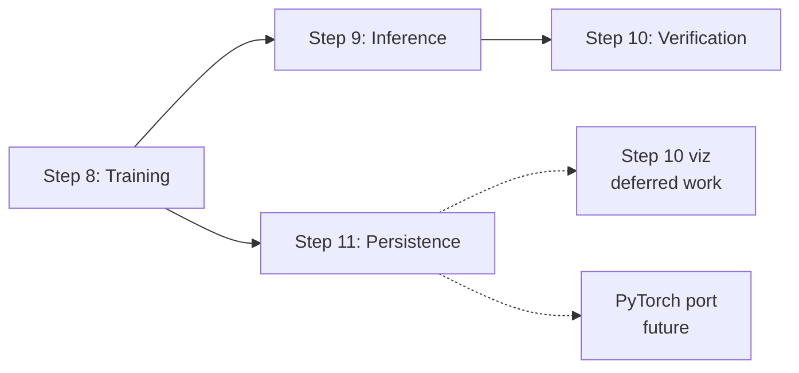

# Step 11: Model Persistence

> **Status**: **Complete** -- design, implementation (`persistence.py`,
> `train_sort.py` integration), and tests (17 in `test_persistence.py`)
> all shipped on 2026-04-26.
>
> **Not a paper concept.** The Transformer paper says nothing about checkpointing;
> this is pure engineering. We treat it as a numbered step anyway because it
> earns the same documentation rigor as the math steps.
>
> **Depends on**: Step 7 (`Transformer.params_and_grads()` contract),
> Step 8 (a runnable training pipeline that produces a trained-in-memory model).

[< Verification](10_verification.md) | [Overview](00_overview.md)

> **See also**: [Reference: Model Capabilities and Limits](reference_capabilities_and_limits.md)
> -- experimental probes (length generalization, vocabulary limits,
> arithmetic, lottery prediction) made possible by Step 11's load-from-disk
> contract. Recommended companion reading after this doc.

---

## 1. Why this step exists

After Step 8, `scripts/train_sort.py` produces a trained `Transformer` -- one
that sorts 5-digit sequences with `>70%` exact-match accuracy. That trained
model lives **only in process memory**. When the script exits, the weights
are gone. There is currently:

- no `save_weights` / `load_weights` anywhere in the codebase,
- no `.npz` of model parameters on disk,
- no way to inspect or visualize a trained model without re-running training.

Today, the only persistent evidence that training worked is
`train_output/loss_curve.csv` (one row per step) and the integration
test `test_trained_model_actually_sorts` in `tests/test_inference.py`.
Both are
fine for "did training run?" but neither lets you take a trained model and
*do something else with it* (decode new inputs, plot attention heatmaps,
compare against a PyTorch port).

Step 11 closes that gap with the smallest possible save/load mechanism that
is correct, robust, and idiomatic to the rest of the codebase.

### A practical motivation

The deferred work in Step 10 -- attention heatmap visualizations from the
paper's Figures 3-5 -- is awkward without persistence: each visualization
script would need to retrain a model inline. With Step 11 in place, you
train once, save once, and every downstream tool (visualization, evaluation,
PyTorch comparison) reads the same artifact.

---

## 2. What "saving a model" actually means

After training, a `Transformer` instance holds a mix of state. Not all of it
is equally important to preserve. Sorted into four piles:

| Pile | Contents | Need to save? |
|------|----------|---------------|
| **A. Learnable parameters** | The arrays the optimizer modifies: embedding matrix, all `Linear` weights and biases (Q/K/V/O projections, FFN W_1/b_1/W_2/b_2), every `LayerNorm` gamma/beta, optionally the untied output `Linear`. | **Always.** This is "the model." |
| **B. Architecture metadata** | Hyperparameters needed to construct the right-shaped Transformer before loading the parameters: `vocab_size`, `d_model`, `num_heads`, `d_ff`, `num_encoder_layers`, `num_decoder_layers`, `p_drop`, `max_len`, `pre_ln`, `tie_embeddings`. | **Always.** Without this you can't allocate the receiving model. |
| **C. Optimizer state** | Adam's per-parameter running averages `m_t` (first moment) and `v_t` (second moment), plus the global step counter `t` used by bias correction. | **Only for resume.** Inference doesn't need it. |
| **D. RNG state** | `np.random.default_rng(seed).bit_generator.state`, used by the batch sampler and dropout. | **Only for bit-exact resume.** Almost never worth the trouble. |

Note the asymmetry between (A) and (B). Parameters alone are useless: a
2D float array of shape `(13, 32)` is meaningless until you know it's the
embedding of a model with `vocab_size=13, d_model=32`. The pair `(A, B)` is
the minimum complete description.

---

## 3. Scope decision: inference-only vs full resume

The first fork in the road. It determines everything else.

| Scope | Saves | Use case | Complexity |
|-------|-------|----------|------------|
| **Inference-only** | A + B | Train once, decode/inspect/visualize many times | Small |
| **Full resume**    | A + B + C (+ D) | Long training runs that need to be checkpointed and continued | Medium |

### Decision: **inference-only** for slice 1

Reasoning:

1. **The pressing concrete need is inference-only.** Step 10's deferred
   attention-heatmap visualization, future PyTorch-vs-NumPy comparison runs,
   and ad-hoc decoding all need params + metadata, never optimizer state.
2. **Training is fast.** End-to-end training takes about 9 seconds on CPU
   per `08_training.md`. Resume is solving a problem we don't yet have.
3. **Inference-only is a strict subset of resume.** If we get save/load of
   `(A, B)` right, adding `(C, D)` later is purely additive: extra keys in
   the same file, extra parameters to the same functions. No rewrite.

We document the resume case in [section 10](#10-future-extension-resuming-training)
so the door stays open.

---

## 4. Format and API decisions

These are smaller choices. Captured here with rationale so future-us doesn't
re-litigate them.

| Choice | Decision | Rationale |
|--------|----------|-----------|
| **File format** | Single `.npz` (compressed) | The repo already uses `np.savez_compressed` for the toy dataset (see `save_sort_npz` in `sort_data.py`). Same primitive, same conventions, no new dependencies. Metadata travels in the same file as zero-dimensional arrays. |
| **Never pickle** | -- | `pickle` is unsafe (arbitrary code on load) and not portable across Python versions. The `np.load(..., allow_pickle=False)` discipline already in `load_sort_npz` is the bar we hold. |
| **API shape** | Free functions in a new `persistence.py` module | Keeps `layers.py` focused on math. Persistence is plumbing; it doesn't deserve to be a method on every layer. Free functions also make the call sites self-documenting: `save_transformer(model, path)` reads better than `model.save(path)` when the function is doing nontrivial bookkeeping. |
| **Storage backend abstraction** | A `Storage` Protocol with two stream-based methods (`open_write`, `open_read`). Two implementations ship: `LocalStorage` (default, no new dependencies) and `FsspecStorage` (opt-in, supports `s3://`, `gs://`, `azure://`, and any other [fsspec](https://filesystem-spec.readthedocs.io) backend). | Decouples *what* persistence does (file format, validation, in-place loading) from *where* the bytes live. Adding cloud support without this would require URI-string sniffing inside every function or a separate code path -- both bad. The Protocol keeps the abstraction open for users to write their own (an in-memory `DictStorage` for tests, an HTTP-only backend for read-only model serving, etc.). See [§11](#11-storage-backends) for the full design. |
| **Load semantics** | "Construct from file": `load_transformer(path, *, storage=None) -> Transformer` | Metadata lives in the file, so load can reconstruct the architecture before filling parameters. Caller doesn't have to remember hyperparameters used at training time. This is a one-call API: `t = load_transformer('train_model/sort_model.npz')` (or `t = load_transformer('s3://bucket/key.npz', storage=FsspecStorage())`). |
| **Default save location** | `train_model/sort_model.npz` (sibling of `src/`, `train_input/`, and `train_output/`) | Separates persisted models from the `train_input/` fixtures folder and from the `train_output/loss_curve.csv` runtime log. Each can be wiped or git-tracked independently. Override via `--save-path`. |
| **Versioning** | `meta.format_version` field, integer, starts at `1`, **committed in slice 1** | Cheapest insurance policy in software engineering. Costs zero to add now; impossible to backfill cleanly later. The contract: *bump only when the new version is a strict superset of the old.* This means future additive extensions (`optimizer.*`, `rng.*`) reuse the same version. Major bumps reserved for incompatible changes (e.g., `float32` storage). |
| **Namespacing** | Every key in the file lives under a top-level namespace: `meta.*`, `params.*`. Future: `optimizer.*`, `rng.*`. | Lets future categories of state be added without colliding with existing keys. A v1 inference loader can sit inside a v1 file containing optimizer state and just ignore the unknown namespace. See §10 for the v1 → v1.1 → v1.2 file diffs. |
| **Crash-safe writes** | Atomic save: write to `<path>.tmp`, `fsync`-equivalent, rename. | Process death mid-save leaves either the previous file or no file -- never a half-written one. `pathlib.Path.replace` is atomic on POSIX and overwrite-replace on Windows. |
| **Validation strictness** | Strict: raise on shape mismatch, dtype mismatch, missing meta keys, missing/extra `params.*` keys, or `format_version > FORMAT_VERSION` | Loud errors are a feature. The category of bug we want to make impossible: "I changed `d_model` from 32 to 64 and got silent garbage predictions." |

---

## 5. The `params_and_grads` contract is what makes this trivial

Everything in pile (A) flows through one method. From `Transformer`:

```1595:1608:nn/numpy-transformer/src/numpy_transformer/layers.py
    def params_and_grads(self):
        out = [
            (p, g, f'embedding.{name}')
            for (p, g, name) in self.embedding.params_and_grads()
        ]
        out.extend(
            (p, g, f'encoder.{name}')
            for (p, g, name) in self.encoder.params_and_grads()
        )
        out.extend(
            (p, g, f'decoder.{name}')
            for (p, g, name) in self.decoder.params_and_grads()
        )
        return out
```

Each sub-layer recursively yields `(param, grad, name)` triples, prefixing
its own name. The result is a flat list with **dotted hierarchical names**
like `embedding.weight`, `encoder.layers[0].mha.W_q.W`,
`decoder.layers[1].ffn.W_2.W`, and so on.

This naming is what holds Steps 7 and 8 together: the optimizer doesn't
need to know the architecture, it just iterates the flat list. We exploit
exactly the same property here. Each name becomes a key in the `.npz`
file, **prefixed with the `params.` namespace** (see §4). The full save
file looks like this:

```text
meta.format_version                       int64 (= 1)
meta.vocab_size                           int64 (= 13)
meta.d_model                              int64 (= 32)
meta.num_heads                            int64 (= 4)
meta.d_ff                                 int64 (= 64)
meta.num_encoder_layers                   int64 (= 2)
meta.num_decoder_layers                   int64 (= 2)
meta.p_drop                               float64 (= 0.1)
meta.max_len                              int64 (= 5000)
meta.pre_ln                               bool   (= False)
meta.tie_embeddings                       bool   (= True)
params.embedding.weight                   float64 (13, 32)
params.encoder.layers[0].mha.W_q.W        float64 (32, 32)
params.encoder.layers[0].mha.W_q.b        float64 (32,)
params.encoder.layers[0].ln_1.gamma       float64 (32,)
... one params.* key per Transformer.params_and_grads() entry ...
```

The save loop is essentially:

```python
arrays = {f'meta.{k}': _to_scalar_array(v) for k, v in metadata.items()}
arrays['meta.format_version'] = np.asarray(FORMAT_VERSION, dtype=np.int64)
for (p, _g, name) in transformer.params_and_grads():
    arrays[f'params.{name}'] = np.ascontiguousarray(p)
_atomic_save(path, arrays)
```

Loading is the dual: read `meta.*` to construct a fresh Transformer, then
for every `(p, _, name)` in its `params_and_grads()`, look up the key
`f'params.{name}'` in the file and copy its contents in-place into `p`.

### Why **in-place** copy on load

Two reasons:

1. **Aliasing safety.** When `tie_embeddings=True`, the embedding matrix
   appears in `params_and_grads()` only once (at the top level), but the
   `Encoder` and `Decoder` both hold references to that same array. If we
   replaced the parameter with a freshly-loaded array, the shared reference
   would break and the encoder/decoder would silently still point at the
   pre-load (random) weights. Copying *into* the existing array (`p[...] = saved_value`)
   keeps every reference live.
2. **Cheap shape validation.** `p[...] = saved_value` raises a clear
   `ValueError` if the shapes disagree. We get strict validation for free.

---

## 6. The tied-embeddings subtlety

This is the one place where naive code can silently misbehave, so it deserves
its own section.

### What tying means

When `tie_embeddings=True` (the default), the input embedding matrix and
the output projection matrix are **the same NumPy array**. From the doc
table in `00_overview.md`, this saves `vocab_size * d_model = 13 * 32 = 416`
parameters and is the paper's setup.

Mechanically, the top-level `Transformer` owns the `Embedding` layer, and
both the `Encoder` and `Decoder` hold a reference to it. The Encoder and
Decoder set `_owns_embedding = False`, so they do **not** include the
embedding in their own `params_and_grads()` list -- otherwise we'd see the
same parameter three times.

### What this means for save

Already correct. `Transformer.params_and_grads()` lists the shared
embedding exactly once, under the key `embedding.weight` (saved as
`params.embedding.weight`). The save loop is naive and right.

### What this means for load

Subtler. Suppose we did:

```python
new_transformer.embedding.weight = saved_weight  # WRONG -- breaks aliasing
```

After this, `new_transformer.embedding.weight` is the new array, but
`new_transformer.encoder.embedding.weight` and `new_transformer.decoder.embedding.weight`
still point at the **old** (random-init) array. The model would forward-pass
on random embeddings and produce nonsense.

**The fix is to mutate in place:**

```python
new_transformer.embedding.weight[...] = saved_weight  # all references see the update
```

Because `new_transformer.encoder.embedding is new_transformer.embedding` is `True`
(same object), the `[...]` write is visible everywhere.

### What this means for **untied** load

When `tie_embeddings=False`, the decoder's output projection is its own
`Linear` layer with its own `W` and `b`. The save file will contain an
extra key like `params.decoder.output.W`. Loading a tied save into an
untied architecture (or vice versa) is a metadata mismatch and we
**fail loudly** in [section 7](#7-validation-strategy): the constructed
model expects `params.decoder.output.W` which the tied save does not
contain, and the missing-key check raises.

---

## 7. Validation strategy

The persistence layer should never silently produce a model that "almost
works." Every load operation does:

1. **Format check.** Refuse `allow_pickle=True`. The file should contain
   only numeric arrays and short metadata.
2. **Version check.** Read `meta.format_version`. Raise if missing
   (`"not a transformer save file"`) or `> FORMAT_VERSION` (`"newer than
   this code supports"`). Versions `1..FORMAT_VERSION` are accepted.
3. **Metadata round-trip.** Read all architecture hyperparameters from
   the `meta.*` keys. Raise if any required field is missing. Use the
   recovered metadata to construct the receiving Transformer. There is
   no "load into a model the caller built" mode; we always build fresh.
   That eliminates one entire class of mismatch (caller built wrong shape).
4. **Param key check** *(within the `params.*` namespace only)*. The set
   `{f'params.{name}' for (_, _, name) in transformer.params_and_grads()}`
   must equal the set of `params.*` keys in the file. Missing or extra
   keys raise with a diff. Other namespaces (`optimizer.*`, `rng.*`,
   etc.) are allowed in the file and **silently ignored** by
   `load_transformer` -- they are owned by separate loaders. This is the
   forward-compatibility hinge: a future v1 file with optimizer state
   still loads in today's code, just without the optimizer.
5. **dtype check.** Each saved parameter's dtype must match the
   constructed model's. Raise on mismatch with the offending name. (All
   parameters are `float64` today; this check is the seam where a future
   `float32` migration would relax.)
6. **Shape check.** After dtype passes, the in-place copy
   `p[...] = saved_value` happens. Even if numpy's broadcasting would
   succeed, we explicitly compare shapes first and raise with a clear
   message including the offending name.

Everything is opt-out by raising. Nothing is opt-in by warning.

---

## 8. Build plan

We built this in four small slices, one per conversation turn, with a
chance to inspect and discuss each before moving on.

### Slice 1: `persistence.py` module -- **shipped**

A new file `numpy-transformer/src/numpy_transformer/persistence.py` with:

- `save_transformer(transformer, path, *, storage=None) -> None`
- `load_transformer(path, *, storage=None) -> Transformer`
- A `Storage` Protocol (stream-based: `open_write`, `open_read`).
- `LocalStorage` (default) -- atomic-write via tmp+rename, no extra deps.
- `FsspecStorage` (opt-in) -- lazy `fsspec` import, supports any fsspec
  URI scheme. Atomicity inherited from the underlying backend.
- The internal helpers (`_to_scalar_array`, `_from_scalar_array`,
  `_read_format_version`, `_read_metadata`, `_validate_param_keys`,
  `_copy_params_in_place`) -- all storage-agnostic.
- Strict validation per [§7](#7-validation-strategy).

Estimate was ~280 lines; landed at 443 lines including docstrings (the
Storage abstraction and the FsspecStorage seekability handling came in
larger than the original sketch). Public API also re-exported from
`numpy_transformer.__init__`. Optional `cloud` extra added to
`pyproject.toml`.

### Slice 2: `train_sort.py` integration -- **shipped**

`scripts/train_sort.py` updated to:

- Accept `--save-path` (default: `<project>/train_model/sort_model.npz`,
  via the new `default_model_dir()` helper).
- Accept `--out-csv` with a parallel default
  `<project>/train_output/loss_curve.csv` (via `default_output_dir()`).
  This separates runtime artifacts from the `train_input/` fixtures
  folder so the dataset and the training outputs have different
  lifecycles.
- After training, call `save_transformer(transformer, save_path)` and
  print the resolved path plus file size in bytes.
- Accept `--no-save` for the test/CI path that doesn't want artifacts.
- `LocalStorage` already auto-creates parent directories via
  `mkdir(parents=True, exist_ok=True)`, so first run cleanly populates
  `train_model/` and `train_output/` if they don't exist.

Smoke run (20 steps, tiny model) reports
`Saved trained model to /tmp/_smoke_model.npz (26,249 bytes)`.

### Slice 3: Tests -- **shipped**

`numpy-transformer/tests/test_persistence.py` (17 tests, all passing in
under a second) covers the originally planned cases plus the new
contracts introduced by the `Storage` abstraction and the
forward-compatibility hardening:

- **Round-trip correctness** (4): tied + untied forward output bit-exact;
  tied aliasing preserved (`is`-checks on encoder/decoder/transformer);
  metadata round-trips with right types.
- **Format-version contract** (4): version 1 is present in saved files;
  loader rejects missing / future / `<1` versions.
- **Validation strictness per §7** (5): missing meta field, missing
  `params.*` key, extra `params.*` key, shape mismatch, dtype mismatch
  -- each raising with the offending name in the message.
- **Forward compatibility** (1): a v1 file containing future
  `optimizer.*` / `rng.*` / arbitrary namespaces still loads and the
  forward pass still matches. This is the §11 hinge.
- **Storage abstraction** (2): `LocalStorage` leaves no `.tmp` behind on
  success; a 14-line in-memory `_DictStorage` (the example from §11.5)
  round-trips a model end-to-end without touching disk or fsspec.
- **End-to-end integration** (1): train, save, load, decode -- decoded
  tokens identical between the in-memory and loaded models.

Full suite remains green: 126 tests pass (109 prior + 17 new).

### Slice 4: Doc closeout + STATUS update -- **shipped**

- This doc's status flipped from "Design phase" to "Complete".
- New row added to `nn/docs/STATUS.md` for Step 11.
- New Discussion Log entry below covering implementation gotchas.

---

## 9. Open questions

These don't need to be answered to start coding, but they are worth holding
in mind. We'll resolve them as they come up.

1. ~~**Versioning.**~~ **Resolved (committed in slice 1).** Save file
   includes `meta.format_version` (currently `1`). Loader raises on
   `format_version > FORMAT_VERSION`. Future *additive* extensions
   (`optimizer.*`, `rng.*`) keep `format_version = 1` because they are
   strict supersets. A bump to `format_version = 2` is reserved for
   *incompatible* changes (e.g., switching params to `float32` storage,
   restructuring embeddings).
2. **Float precision.** The codebase is `float64` everywhere. A future
   memory-optimization slice might want `float32` saves with optional
   upcast on load. Out of scope for now; this would warrant a
   `format_version = 2` bump because old loaders would silently produce
   `float64` arrays loaded from `float32` saves (loud failure required).
3. **Multiple architectures per file.** Could we save several models in
   one file (e.g., teacher and student)? Lean: no. One model per file.
   If you want a bundle, write a tiny wrapper. Namespacing makes it
   *possible* (`student.params.*`, `teacher.params.*`) but the
   conceptual cleanliness of "one file = one model" is worth more than
   the convenience.

---

## 10. Future extension: resuming training

If we later need pile (C) (optimizer state) and pile (D) (RNG state), the
shape of the change is purely additive at the file level. **No existing
key ever changes shape, dtype, or meaning.** That's the contract.

### File-level evolution

**v1.0 today (inference-only):**

```text
meta.format_version    = 1
meta.vocab_size        = 13
meta.d_model           = 32
... (all 11 meta fields)
params.embedding.weight                 (13, 32) float64
params.encoder.layers[0].mha.W_q.W      (32, 32) float64
... (all params from params_and_grads())
```

**v1.1 future (+ optimizer state for resume):**

Same as v1.0, **plus** a new namespace:

```text
optimizer.t                               int64    # global step counter
optimizer.params.embedding.weight.m       (13, 32) float64
optimizer.params.embedding.weight.v       (13, 32) float64
optimizer.params.encoder.layers[0].mha.W_q.W.m   (32, 32) float64
optimizer.params.encoder.layers[0].mha.W_q.W.v   (32, 32) float64
... one (m, v) pair per parameter ...
```

A v1.0 reader sees this file, ignores the `optimizer.*` namespace, and
loads inference-only. A v1.1 reader sees a v1.0 file (no `optimizer.*`),
notes the optimizer is absent, and either returns `optimizer=None` or
raises -- caller's choice via a flag.

**v1.2 future (+ RNG state for bit-exact resume):**

Same as v1.1, **plus**:

```text
rng.bit_generator   = "PCG64"     # string, identifies the generator
rng.state           = uint64[...] # the bit_generator state blob
```

Each step is purely additive. The same `format_version = 1` covers all
three because they are strict supersets.

### Code-level changes that ride along

- **Adam state must be keyed by parameter name, not `id(param)`.** Today,
  `Adam` in `training.py` keys its `m`/`v` state by `id(param)` (the
  in-process memory address). That is fine for in-memory training but
  **useless across processes**. Slice 1 does not need to fix this --
  `Adam.step()` already receives `(param, grad, name)` triples from
  `params_and_grads()`, so the refactor is localized: switch the dict
  key from `id(param)` to `name`. We just need to *not paint ourselves
  into a corner* in slice 1, and we don't.
- **`save_transformer` grows an optional `optimizer=None` parameter.**
  When given, it serializes `Adam.state_dict()` into the `optimizer.*`
  namespace.
- **`load_transformer` grows an optional `with_optimizer=False` flag.**
  Default `False` returns just the Transformer (the v1.0 behavior).
  `with_optimizer=True` returns `(transformer, adam)` and raises if the
  file lacks optimizer state.
- **The Noam schedule is a pure function of `step`**, so persisting
  `optimizer.t` (or recomputing the step number from it) is sufficient
  to resume the LR curve exactly.
- **RNG state** uses `rng.bit_generator.state` (a dict) flattened into
  a string identifier and a `uint64` array.

The fact that all of this is additive is a direct consequence of the
`params_and_grads()` contract plus the namespacing decision. The naming
convention extends naturally.

---

## 11. Storage backends

The persistence layer is split cleanly along one axis: **what** to save
(file format, namespacing, validation, in-place load) versus **where**
the bytes live (local disk, S3, GCS, in-memory dict for tests, etc.).
The split is enforced by the `Storage` Protocol.

### 11.1 The `Storage` Protocol

```python
class Storage(Protocol):
    def open_write(self, key: str) -> AbstractContextManager[BinaryIO]: ...
    def open_read(self, key: str) -> AbstractContextManager[BinaryIO]: ...
```

Two methods, both context managers yielding a binary file-like object.

**Why streams not bytes?** `np.savez_compressed` and `np.load` already
want file-like objects -- streams compose naturally without an extra
in-memory copy. For a future big model, streaming saves the cost of
buffering gigabytes in memory.

**Atomicity contract.** When `open_write(key)` exits *without* exception,
the data at `key` is observably the new data. When it exits *with* an
exception, the data at `key` is either unchanged (atomic backend) or in
an unspecified state (best-effort backend). Implementations should aim
for atomicity; the doc string for each implementation says exactly what
guarantee it provides.

### 11.2 `LocalStorage` (default)

Atomic-write via tmp+rename:

1. Compute a sibling path `<key>.tmp`.
2. Open `<key>.tmp` for write, hand it to the caller.
3. On clean exit, `Path.replace` the tmp onto the destination.
4. On any exception, delete the tmp (best-effort) and re-raise.

`Path.replace` is atomic on POSIX (`rename(2)` syscall). On Windows it
is overwrite-rename, which is near-atomic in practice -- the destination
is never half-written, but a concurrent reader could in theory observe
the brief moment where the destination doesn't exist. Acceptable for our
single-writer use case.

Used as the default when no `storage=` argument is passed:

```python
save_transformer(model, "train_model/sort_model.npz")
# equivalent to:
save_transformer(model, "train_model/sort_model.npz", storage=LocalStorage())
```

### 11.3 `FsspecStorage` (opt-in, cloud-friendly)

Wraps [fsspec](https://filesystem-spec.readthedocs.io), the de facto
Python filesystem abstraction (also used by pandas, dask, polars).
fsspec dispatches by URI scheme:

- `s3://bucket/key.npz`          (requires `s3fs`)
- `gs://bucket/key.npz`          (requires `gcsfs`)
- `azure://container/key.npz`    (requires `adlfs`)
- `file://path/to/key.npz`       (built-in)
- `https://host/key.npz`         (read-only, built-in)
- ...and many more.

Lazy import: `fsspec` is imported only when `FsspecStorage` is
instantiated, so users who never touch cloud storage pay no import cost
and don't need fsspec installed. If fsspec is missing, the constructor
raises `ImportError` with a clear `pip install` hint.

```python
storage = FsspecStorage()                              # default profile
storage = FsspecStorage(key="...", secret="...")       # explicit creds
storage = FsspecStorage(profile="prod", region="us-west-2")
save_transformer(model, "s3://bucket/sort_model.npz", storage=storage)
```

`storage_options` kwargs are forwarded to `fsspec.open` -- this is how
authentication, endpoint URLs, regions, and per-backend tuning are
configured.

**Atomicity for fsspec backends:**

| Backend | Atomic on `open_write` exit? | Why |
|---------|------------------------------|-----|
| `s3://`     | Yes | `put_object` is atomic at the bucket level |
| `gs://`     | Yes | GCS object writes are atomic |
| `azure://`  | Yes | Azure Blob upload is atomic |
| `file://` (via fsspec) | **No** | fsspec writes directly to destination |
| `https://`  | Read-only | -- |

**For local files, prefer `LocalStorage` over `FsspecStorage` with
`file://`** -- `LocalStorage` does proper tmp+rename, fsspec's local
backend does not.

### 11.4 The seekability quirk on load

`.npz` is a ZIP archive. ZIP requires random access (the central
directory lives at the end of the file). Some fsspec streams are not
seekable -- `https://`, certain caching configurations, etc.

`load_transformer` handles this by reading the entire stream into a
`BytesIO` buffer before handing it to `np.load`. Two implications:

- For a 13-vocabulary, 32-dim, 2-layer toy model, the file is well under
  100 KB; in-memory buffering is free.
- For a real production model (gigabytes), this becomes an O(model size)
  memory hit on load. If that ever matters, the right fix is a
  Storage-level "download to local cache, then read" pattern, not a
  change to the `load_transformer` API.

This assumption is documented in `persistence.py` and worth revisiting
the day someone tries to load a model bigger than RAM.

### 11.5 Choosing a backend

| Where the bytes live | Recommended backend | Notes |
|----------------------|--------------------|-------|
| Local filesystem | `LocalStorage` (default) | True atomic via tmp+rename |
| AWS S3 | `FsspecStorage` + `s3fs` | Atomic via PUT |
| Google Cloud Storage | `FsspecStorage` + `gcsfs` | Atomic |
| Azure Blob Storage | `FsspecStorage` + `adlfs` | Atomic |
| HTTP read-only | `FsspecStorage` (default deps) | Read-only |
| In-memory (tests) | Custom `Storage` impl, ~10 lines | Doesn't need fsspec |

The "custom Storage" row is the point. The Protocol means a test that
wants to round-trip a model without touching disk just writes:

```python
class DictStorage:
    def __init__(self) -> None:
        self._blobs: dict[str, bytes] = {}
    @contextmanager
    def open_write(self, key: str) -> Iterator[BinaryIO]:
        buf = BytesIO()
        yield buf
        self._blobs[key] = buf.getvalue()
    @contextmanager
    def open_read(self, key: str) -> Iterator[BinaryIO]:
        yield BytesIO(self._blobs[key])
```

That's it. No filesystem, no fsspec, no IO. Slice 3 will use this
pattern in tests.

### 11.6 Optional dependency wiring

`fsspec` is declared in `pyproject.toml` as `[project.optional-dependencies]`:

```toml
[project.optional-dependencies]
cloud = ["fsspec", "s3fs"]
```

Install patterns:

```bash
# default: no cloud support
uv sync --package numpy-transformer

# with cloud support (S3 included)
uv sync --package numpy-transformer --extra cloud
```

Adding GCS or Azure later is a matter of adding `gcsfs` or `adlfs` to
the extra. `LocalStorage` always works with the default install.

---

## 12. Where this slots in the build order



Step 11 unblocks two pieces of deferred work:

- **Step 10's attention heatmap visualizations** (paper Figures 3-5).
  Each viz script can now `load_transformer(...)` instead of retraining.
- **The PyTorch port** in `nn/pytorch-transformer/`. A persisted NumPy
  model is the obvious ground truth for cross-implementation comparison.

---

## Discussion Log

### 2026-04-26: Origin of this step

This step was not in the original 0-10 plan. It was discovered organically
through three Q&A exchanges in chat:

**Q: How do I know if the model is trained?**

The honest answer surfaced the gap. There is no persisted trained model in
the workspace today. `data/loss_curve.csv` exists but contains only one
row (step 1, loss 2.59) -- a previous training run was started but didn't
get past the first step. Worse, the training script doesn't checkpoint:
weights live in process memory only, get evaluated immediately, and vanish
on exit.

The four pieces of evidence that *would* indicate a successful training
run, were one to be performed:

1. `data/loss_curve.csv` showing loss falling from `~log(13) ≈ 2.56`
   toward the label-smoothing floor (`~0.78` for `eps=0.1, V=13`).
2. Greedy-decode demo lines on stdout matching `[OK ]` on each example.
3. Final exact-match accuracy `>70%` on held-out 5-digit sequences.
4. The integration test `test_trained_model_actually_sorts` passing.

But all four are ephemeral. None of them give you a model object to
*do something with* later. Step 11 fixes that.

**Q: Is `--steps` the same as epoch?**

This question doesn't directly motivate persistence but it confirms a
design choice: the training loop in `training.py` samples with replacement
from the dataset every step (no epoch concept), and the Noam learning-rate
schedule is parameterized in steps not epochs. Implication for Step 11:
when we eventually add resume support (pile C), we persist `step`, not
`epoch`. The codebase has no notion of an epoch boundary to checkpoint at.

This Q&A belongs canonically in `08_training.md`'s Discussion Log;
captured here in summary because it directly informs the resume design.

**Decision: persist this design before any code lands.**

The user explicitly asked to record all the details in a doc first. That
matches the project's "documentation first" rule. This file is the
permanent reference; the code that follows must conform to it.

### 2026-04-26: Naming convention

The user originally requested the filename `11_model_persistant.md`.
Renamed to `11_model_persistence.md` to match the noun-phrase pattern of
the rest of the docs (`08_training.md`, `09_inference.md`,
`10_verification.md`) and to use the standard English spelling. Easy to
rename if a different convention is preferred.

### 2026-04-26: Forward-compatibility hardening

**Q: Can `persistence.py` be extended to include optimizer and RNG state
without breaking or corrupting?**

The answer surfaced five decisions that needed to be locked down *before*
slice 1, not deferred:

1. **`format_version` is a slice-1 commitment, not an open question.**
   The cheapest piece of insurance in software engineering. Costs zero
   to add now; impossible to backfill cleanly later. The contract: bump
   only for *incompatible* changes; additive extensions reuse the same
   version.
2. **All keys are namespaced.** Originally the design had unprefixed
   parameter keys (`embedding.weight`). Revised to put every key under
   a top-level namespace (`meta.*`, `params.*`). Future categories of
   state (`optimizer.*`, `rng.*`) are then guaranteed not to collide.
3. **Param key validation is subset-within-namespace, not equal-set
   over the whole file.** The original §7 said the param-name set must
   *equal* the file's keys. That is too strict: it would refuse to load
   any future v1 file that happens to contain optimizer state. Revised
   so the check is scoped to `params.*` only; other namespaces are
   silently ignored at this layer.
4. **Atomic writes.** `<path>.tmp` + `Path.replace`. Process death
   mid-save leaves either the previous file or no file -- never a
   half-written one. Cheap to add; expensive to omit and discover later.
5. **Adam state must be keyed by parameter name (when we get there).**
   Today, `Adam` keys its `m`/`v` by `id(param)`. That's a memory address;
   useless across processes. The refactor for resume support is
   localized -- switch the dict key from `id(param)` to `name` -- and
   slice 1 does not need to do it. Slice 1 just needs to *not paint
   ourselves into a corner*, which the namespacing decision ensures.

The three properties we are buying with these decisions:

- **Backward compatibility**: new code reads old files (no missing keys
  from any future-required field; required keys are stable forever).
- **Forward compatibility**: old code reads new files (subset-style
  validation makes this work; v1 inference loader can read a v1 file
  containing optimizer state).
- **No corruption**: atomic writes guarantee a save that *looks* valid
  *is* valid.

The one thing this design *cannot* save us from is an architecture
migration that removes a parameter (e.g., replacing `LayerNorm` with
`RMSNorm`). Old saves would contain orphan keys. Correct behavior in
that case is to fail loudly via the missing/extra param-key check --
that's a deliberate architecture migration, not a persistence-layer
concern.

Concrete revisions to this doc: §2 (added `max_len`), §4 (added
versioning, namespacing, crash-safe-writes rows), §5 (showed the full
file layout with namespaced keys), §6 (param keys now show
`params.<name>`), §7 (subset-within-namespace validation; explicit
version and dtype checks), §9 (resolved versioning), §10 (concrete
file-level diffs for v1.0 → v1.1 → v1.2).

### 2026-04-26: Storage backend abstraction (Options B + C)

**Q: Would there be any change needed if AWS S3 is the target persistent
store?**

The walk-through identified four lines of `persistence.py` that were
local-filesystem-specific (typing, `mkdir`, tmp+rename, cleanup) and
~250 lines that were storage-agnostic (file format, namespacing,
validation, in-place load). Three options surfaced:

- **A.** URI-string sniffing inside the existing functions
  (`s3://...` → S3 branch). Pragmatic but doesn't scale; `path: Path`
  becomes a lie.
- **B.** A `Storage` Protocol with pluggable implementations.
- **C.** Use [fsspec](https://filesystem-spec.readthedocs.io) directly.

**Decision: implement *both* B and C in slice 1.** The user explicitly
asked for an "adaptable" approach -- B is the abstraction layer
(`Storage` Protocol), C is one of the implementations (`FsspecStorage`).
The other implementation, `LocalStorage`, ships with no new dependencies
and is the default.

The atomicity insight -- that S3 PUT is atomic at the object level
while local filesystems are not -- justified pushing atomicity down
into each backend. `LocalStorage` does explicit tmp+rename;
`FsspecStorage`'s atomicity is whatever the underlying fsspec backend
provides (S3/GCS/Azure: yes; fsspec's local file://: no -- which is
exactly why `LocalStorage` exists as a separate, opinionated implementation
for local files rather than punting to fsspec).

The seekability gotcha (`.npz` is ZIP, ZIP needs random access, some
fsspec streams aren't seekable) is handled by reading the full blob
into `BytesIO` on load. Fine for our model size; flagged in
[§11.4](#114-the-seekability-quirk-on-load) as something to revisit if
we ever load a model larger than RAM.

The `Storage` Protocol stayed minimal -- two methods, both context
managers -- so users can write their own backends in ten lines (an
in-memory `DictStorage` for tests, a read-only HTTP backend for model
serving, etc.). Slice 3's tests will use a custom in-memory backend
to avoid touching disk at all.

Concrete additions: §4 (storage-backend row), §8 (slice 1 now includes
abstraction), new §11 ("Storage backends" with full design, choice
matrix, seekability quirk, and pyproject wiring), §12 (renumbered from
old §11). Code: `Storage` Protocol, `LocalStorage`, `FsspecStorage`,
plus an `[project.optional-dependencies] cloud` extra.

### 2026-04-26: Slices 1-3 implementation notes

The build went mostly as designed. A few small things worth recording
because they will come up again the next time someone touches this
module.

**`Protocol` is intentionally not `@runtime_checkable`.** During slice 3
the test for `_DictStorage` initially included an
`isinstance(storage, Storage)` sanity check. That raised
`TypeError: Instance and class checks can only be used with
@runtime_checkable protocols`. The fix was to drop the assertion --
`Storage` is a structural type, and the round-trip test that follows
already proves the structural fit. The decision to leave `Storage`
non-`@runtime_checkable` is deliberate: runtime structural checks are a
footgun (they walk attributes without type-checking), and we never
actually need `isinstance` for dispatch.

**FsspecStorage typing noise.** `basedpyright` flagged the `fsspec`
imports inside `FsspecStorage` because the package is optional
(`pip install numpy-transformer[cloud]`). Lazy imports stay at the
method/constructor level so users without the extra pay zero cost; the
linter warnings are silenced with inline
`# type: ignore[import-not-found] # pyright: ignore[reportMissingImports]`
comments. This is the correct shape for an optional dependency: the
runtime check (`ImportError` with a friendly message in the constructor)
is the source of truth, and the static-analysis suppression is
cosmetic.

**Test corruption pattern.** Half the test file is "save a normal file,
edit one key in a `dict`, write it back, expect `load_transformer` to
raise." Factored that into a single `_rewrite_npz(path, mutate)` helper
where `mutate` is a one-line lambda
(`lambda a: a.pop("meta.format_version")`,
`lambda a: a["params.embedding.weight"] = ...`). Keeps each corruption
test declarative and one-thought-per-test.

**Test style mirrors the existing tree.** Rather than `pytest.raises`,
the existing `test_inference.py` uses `try / except ValueError as e: ...
else: raise AssertionError(...)`. New tests follow the same convention
(no `pytest` import in the test file at all). `tmp_path` is still a
pytest fixture-by-convention -- it works without an explicit import.

**One thing the module does *not* do yet, deliberately.** `Adam.state`
is still keyed by `id(param)` in `training.py`. Slice 1's design called
out that this needs to switch to `name`-keyed before resume support
ships, and the Discussion Log entry above on forward-compatibility
hardening already documents the migration. We did *not* take that
detour now -- inference-only persistence works today, and changing
`Adam` would have invalidated all of `test_training.py`'s
state-by-`id` assertions. That refactor is a clean, isolated change for
the day someone wants to add resume.

**Final shape on disk.** A trained tiny model
(`d_model=8, num_heads=2, d_ff=16, num_layers=1`) serializes to about
26 KB compressed. The full sort model (`d_model=32, num_heads=4,
d_ff=64, num_layers=2`) lands at a few hundred KB -- still a
rounding-error compared to the dataset itself.

### 2026-04-26: First post-persistence experimental session

This is what Step 11 was built for, and it paid off the same day.

After the slices shipped, we ran the full sort training (2000 steps,
default config), achieved **100% accuracy on 1000 held-out test
examples**, and saved the model to `train_model/sort_model.npz`
(356,027 bytes). Then -- without retraining -- we loaded it back in a
fresh Python process and exercised it across a series of
out-of-distribution probes. That session generated a substantial body
of conceptual material that has been folded into a dedicated reference
doc: [`reference_capabilities_and_limits.md`](reference_capabilities_and_limits.md).

The headline findings, summarized here for cross-reference:

- **Save/load is byte-perfect.** Two independent loads of the same
  `.npz` produce bit-identical parameter arrays across all 43,168
  float64 elements (verified via `np.array_equal` on every parameter).
  Tied-embedding aliasing is preserved -- a write to `master.weight[0,0]`
  propagates to the encoder view, the decoder view, and the
  `output_projection`'s `shared_owner.weight`. The in-place
  (`param[...] = saved_value`) load semantic is doing exactly what
  Section 6 promised.
- **Length generalization fails as predicted.** A model trained on
  `seq_len=5` produces exactly 5 tokens for inputs of length 6, 7, 8,
  9, or 10 -- always sorted, always from the input multiset, always
  followed by EOS at decoder position 5. Surprising emergent behavior:
  the picks approximate **5-quantile order statistics** of the sorted
  input, suggesting that cross-attention over more source positions
  than query slots produces a chunk-averaging effect. Detailed in
  Section 3 of the reference doc.
- **Vocabulary is a hard floor.** Token IDs >= 13 produce `IndexError:
  index N is out of bounds for axis 0 with size 13` at the embedding
  lookup. Digit-by-digit tokenization "works" mechanically but solves
  the wrong problem (digit-sort, not number-sort) -- a lesson that
  generalizes directly to why LLMs are bad at arithmetic. Detailed in
  Sections 4-5 of the reference doc.
- **Lottery prediction is information-theoretically impossible**, not
  a model-size or training-data problem. Independence of i.i.d. draws
  means the Bayes-optimal predictor is the marginal distribution; any
  trained model converges to uniform output. Detailed in Section 6 of
  the reference doc.

The unifying lesson is captured in Section 7 of the reference doc and
worth restating here: **the training distribution is the capability
boundary**. Persistence (Step 11) is what made it possible to test
this principle without the cost of retraining from scratch for every
probe.
